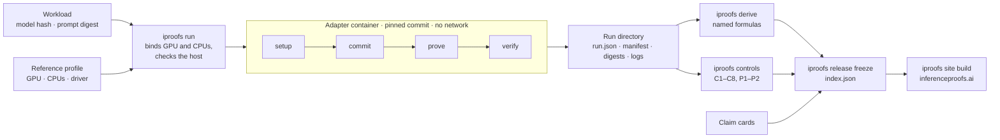

<div align="center">

<a href="https://www.inferenceproofs.ai"></a>

<h1>Inference Proofs</h1>

<p><strong>An open benchmark for provable inference.</strong><br>
Shared open-weights models, standardized hardware, consistent timing rules,<br>
and a claim card next to every number explaining what the proof actually establishes.</p>

<a href="https://github.com/ai-verification-observatory/inference-proofs/actions/workflows/ci.yml"></a>
<a href="releases/v1.0/board.json"></a>
<a href="https://www.inferenceproofs.ai"></a>
<br>
<a href="pyproject.toml"></a>
<a href="https://docs.astral.sh/uv/"></a>
<a href="docs/spec/07-testing-strategy.md"></a>
<a href="https://docs.astral.sh/ruff/"></a>
<br>
<a href="rfcs/README.md"></a>
<a href="LICENSE"></a>
<a href="LICENSES/CC-BY-4.0.txt"></a>
<a href="CONTRIBUTING.md"></a>

<p>
<a href="https://www.inferenceproofs.ai"><b>Results</b></a> ·
<a href="https://www.inferenceproofs.ai/learn"><b>Learn</b></a> ·
<a href="docs/SPEC.md"><b>Specification</b></a> ·
<a href="rfcs/README.md"><b>RFCs</b></a> ·
<a href="docs/PRD.md"><b>PRD</b></a> ·
<a href="systems/README.md"><b>Add a system</b></a> ·
<a href="docs/spec/10-glossary.md"><b>Glossary</b></a>
</p>

</div>

---

## Contents

- [Why this exists](#why-this-exists)
- [What gets measured](#what-gets-measured)
- [Anatomy of a number](#anatomy-of-a-number)
- [The claim card](#the-claim-card)
- [Timing scopes](#timing-scopes)
- [Negative controls](#negative-controls)
- [How a run works](#how-a-run-works)
- [Level 1, release v1.0](#level-1-release-v10)
- [Quick start](#quick-start)
- [Repository layout](#repository-layout)
- [Principles and non-goals](#principles-and-non-goals)
- [Contributing](#contributing)
- [Licence](#licence)

---

## Why this exists

Several open-source systems can now cryptographically prove that a language model produced a given output. Each project publishes its own benchmarks, yet those numbers are almost impossible to compare side by side because four variables change at once:

| Variable | Why published results diverge | How this benchmark controls it |
|---|---|---|
| **Model** | An 8B dense model vs a 400B mixture-of-experts model at a different precision | Pinned [workloads](rfcs/0003-workloads.md): models identified by public source and content hash, prompt sets pinned by digest |
| **Hardware** | Each team's own GPU, driver, and CPU setup | Standardized [reference profiles](rfcs/0006-reference-hardware-and-cost.md) with full machine records and CPU pinning |
| **Timing rule** | "Proving time" may or may not include start-up, weight commitment, or batching | Explicit [timing scopes](#timing-scopes) measured by our harness from outside the prover container |
| **Claim** | One proof binds the weights, another samples activations, a third checks a single layer | A [claim card](#the-claim-card) per configuration, copied directly from the system's own documentation |

The first three differences can be standardized away. The fourth cannot: two systems proving fundamentally different statements are doing different work, not simply running faster or slower. Inference Proofs therefore standardizes what it can and **explicitly labels what it cannot**. It follows the spirit of [Ethproofs](https://ethproofs.org/) for zkVMs, with one addition tailored to AI inference: the claim card.

> [!IMPORTANT]
> This project **runs** proof systems and ranks passing systems within each model rung by a single measured figure: the cost of generating and proving a reply as a multiple of unproved serving ([RFC-0018](rfcs/0018-level-1-ladder.md)). It does not build or certify provers, and it never ranks systems across different models.

## What gets measured

Every system runs at a pinned full Git commit hash using only documented settings, wrapped in a five-subcommand [adapter contract](rfcs/0005-adapter-contract.md). Level 1 v1.0 runs execute on hosted GPUs: manifests record the hosting environment, and verify traces record every file opened by the verifier (though not network connections).

```
info → setup → commit → prove → verify
```

The harness times every call and proof release from outside the container ([RFC-0011](rfcs/0011-measurement-and-sampling.md)), samples GPU and host telemetry via NVML and cgroups, tests every verifier against the same tampering controls ([RFC-0008](rfcs/0008-negative-controls.md)), and recomputes all derived metrics in CI from the raw records ([RFC-0004](rfcs/0004-metrics-timing-grades.md)).

Each prover is also paired with a **production-serving reference row** ([RFC-0015](rfcs/0015-reference-rows.md)): the same model served without proofs by vLLM at the publisher's release precision (using default settings) on the same GPU generation. Proving overhead is computed directly against that baseline in GPU-seconds per reply, with its timing scope attached.

## Anatomy of a number

Every metric stored in this repository uses one structured `quantity/1` schema ([RFC-0012](rfcs/0012-schemas-and-serialization.md)) so no number ever appears without its metadata. Here is a verbatim example from a stored v0.1 run:

```jsonc
// results/v0.1/sash/2026-11-09-sash-sash-l31-8b-c1024-prover-h200-hosted-1/run.json
"active_param_tokens_per_second_prove.session": {
  "value": 1669204795.273114,
  "unit": "param_token/s",
  "scope": "prove.session",          // which clock events bound it
  "grade": "derived",                // how it was obtained
  "tier": "reported",                // who has verified the run
  "null_reason": null,
  "source": {
    "kind": "derivation",
    "ref": "derive:D-APT-S@0.1.0.dev0", // formula id and harness version
    "inputs": [
      ".../run.json#/metrics/rate_prove.session",
      ".../run.json#/inputs/active_parameters_per_token"
    ]
  }
}
```

Three controlled vocabularies govern every published number:

<table>
<tr><th>Grade: how it was obtained<br><sub><a href="rfcs/0004-metrics-timing-grades.md">RFC-0004</a></sub></th><th>Evidence tier: who ran it<br><sub><a href="rfcs/0007-evidence-tiers-and-reproduction.md">RFC-0007</a></sub></th><th>Wording: what a check establishes<br><sub><a href="docs/spec/10-glossary.md">Glossary</a></sub></th></tr>
<tr valign="top"><td>

| Grade | Meaning |
|---|---|
| `measured` | recorded directly by our harness |
| `derived` | computed in CI from a named formula |
| `projected` | estimated by a documented cost model |
| `external` | taken from a pinned public source |
| `asserted` | a fixed input (e.g., GPU price) with source and date |

</td><td>

| Tier | Meaning |
|---|---|
| `reported` | run by one operator, not yet rerun externally |
| `peer-reviewed` | reserved for future review |
| `reproduced` | reserved for external reruns |

Every run currently recorded by the harness has tier `reported` ([RFC-0007](rfcs/0007-evidence-tiers-and-reproduction.md)). In prose, always label reported numbers with their scope and tier.

</td><td>

| Word | Use |
|---|---|
| **proved** | established by a sound verifier's acceptance |
| **bound** | a computation link constrained by verification |
| **sampled** | statistical check over a random subset |
| **attested** | vouched for by hardware or a signer |

Never say "provably safe".

</td></tr>
</table>

Derived metrics are always **computed, never hand-typed**. CI recomputes every derived value from its raw inputs bit for bit and fails on any discrepancy.

## The claim card

A claim card ([RFC-0002](rfcs/0002-claim-card.md)) is a machine-checkable record of what an accepted proof establishes for a specific system configuration: the proved relation, security notion and bit level, underlying assumptions, which edges of the computation are bound, and the **residual** (what a cheating prover can still get away with while passing verification).

Every entry is copied verbatim from the system's documentation at the pinned commit with a line-anchored link, or marked `not stated` where the documentation is silent. Nothing is inferred. Here is an excerpt from [`systems/sash/claim.yaml`](systems/sash/claim.yaml):

```yaml
upstream: {repo: "sg-ai-safety-hub/zk-inference-prover", commit: "4f41667297430a598165c4a8604258fe37d952ae"}
claim_class: "greedy-continuation/exact-match/committed-weights"
security:
  notion:
    kind: "not_stated"
  level: >-
    100 conjectured bits for each segment proof, by stwo's own conjectured-soundness accounting
    [...] A level for the whole grid of segments is not stated.
zero_knowledge: {claimed: "not stated", hidden: "not stated", not_hidden: "not stated", status: "not_stated"}
```

Before a system can be ranked on Level 1, it must clear six entry checks run by our harness ([RFC-0018](rfcs/0018-level-1-ladder.md#the-six-checks)):

| Check | Requirement to pass |
|---|---|
| **Run** | Three cold-start sessions on fixed prompt slots, built from the pinned public commit, each returning an accepted proof for every request |
| **Model** | Altering a single weight never produces an accepted proof against the original commitment, and an honest proof is rejected against the altered commitment |
| **Prompt** | Modifying one prompt token causes the verifier to reject the proof |
| **Reply** | Every proof covers all 512 reply tokens, and modifying the first, last, or an interior reply token causes rejection |
| **Verify without weights** | Every verdict runs with no GPU visible and no model files on disk, confirmed via a file-open trace |
| **Fidelity** | Proved replies match more leading tokens of the original model than the pass bar (a deliberately damaged copy), setting a basic quality floor |

None of these checks attempt adversarial forgery: soundness and weight secrecy are not empirically tested.

Alongside the checks, a five-petal **glyph** summarizes how close each system is to an ideal prover ([RFC-0018](rfcs/0018-level-1-ladder.md#the-glyph)). Each petal receives one grade: `Met`, `Mostly met`, `Partly met`, `Not met`, `Not stated`, `Failed` (contradicted by a check or proof rebuild), or `Not decided`. Colours are rendered visually without naming them in text:

| Petal | Protects | What Met requires |
|---|---|---|
| **Integrity** (soundness) | Customer | A proved soundness bound covering the exact setup we run, with every exponent at least 128 (in `2^-t` or `q/2^t`, the exponent is `t`) |
| **Confidentiality** (zero knowledge of weights) | Provider | Zero knowledge proved for the exact configuration and batch size we run, stated for the compiled programs, plus a published list of visible values with nothing depending on the weights |
| **Fidelity** (quantization drift in matched leading tokens) | Customer | Proved replies score significantly above the midpoint between a rerun of the original model and its 8-bit copy in a one-request-at-a-time fidelity run |
| **Formally verified** (machine-checked soundness proof) | Customer | A machine-checked soundness theorem covering the actual verifier binary we run, with its trusted base listed, no unverified input-reading code outside the proof, and a passing rebuild by us using the publisher's pinned toolchain |
| **Trust assumptions** (trusted setup or party) | Customer | Explicit publisher statement that soundness rests solely on cryptography, with no setup secret |

Four statement petals (Integrity, Confidentiality, Formally verified, Trust assumptions) are computed deterministically from quoted facts extracted from the publisher's documentation at the pinned commit (`systems/<name>/properties.yaml`); no grade is entered by hand. Whenever a fact relies on our interpretation rather than a single explicit sentence, it carries a note, the site marks the petal as our reading, and the grade is capped at `Mostly met`. Fidelity comes directly from our fidelity run, and any failed entry check overrides contradicted petals to `Failed`. Each system page lists everything still missing for `Met` along with who must act (the publisher or us). Petals are never combined into a single score and never change a system's ranking.

## Timing scopes

Every latency and throughput number carries exactly one timing scope ([RFC-0004 INV-SCOPE-1](rfcs/0004-metrics-timing-grades.md#timing-scopes)), bounded by harness monotonic clock events (`time.monotonic_ns()`). A proof's release timestamp is the moment the harness observes its atomic rename into `/io/proofs/`.

| Scope | Starts at | Ends at | Tokens attributed |
|---|---|---|---|
| `commit` | `commit` call start | `commit` call exit | none |
| `prove.session` | `prove` call start | release of last proof | all proofs |
| `prove.steady` | last release in first batch | release of last proof | requests after first batch |
| `whole_wall` | `commit` call start | release of last proof | all proofs |
| `verify` | `verify` call start (8-CPU verifier) | that call's exit | the proof's tokens |
| `verify.single_thread` | same (1-CPU verifier) | that call's exit | the proof's tokens |

`prove.steady` excludes start-up overhead, while `prove.session` includes it. Systems that release all proofs together at the end have no steady-state scope, and their headline figure labels whole-session scope explicitly.

## Negative controls

Timing honest runs alone cannot distinguish a real verifier from one that blindly accepts everything. Our harness applies the same suite of tampering controls ([RFC-0008](rfcs/0008-negative-controls.md)) to every verifier from outside the adapter:

| Id | Modification | Expected outcome |
|---|---|---|
| C1 | Alter a claimed output token | `reject` |
| C2 | Alter one prompt token in the request | `reject` |
| C3 | Verify against a commitment from perturbed weights | `reject` |
| C4 | Replay a valid proof for a different request | `reject` |
| C5 | Truncate the largest proof file the verifier reads | `reject` or `invalid_call` |
| C6 | Flip one bit at a seeded offset in a read proof file (5 seeds) | `reject` or `invalid_call` on every seed |
| C7 | Swap the proofs of two requests within a batch | `reject` |
| C8 | Remove one proof file the verifier reads | `reject` or `invalid_call` |
| P1 | Commit weights W, then prove with perturbed weights W′ | `prover_failed` or `reject` |
| P2 | Prove at a different precision than committed | `prover_failed` or `reject` |

Every control trial runs alongside an untouched **honest twin** inside the same batch and container image. If the honest twin fails to verify, the trial is marked `void` rather than counting as a rejection. Flags that weaken a prover's guarantees (such as SASH's `--unsound-skip-*`) are permitted only inside dedicated negative-control jobs and never in measured runs.

## How a run works



The verifier always checks against the commitment recorded by the harness during `commit`, never against metadata bundled with a proof. Raw proof bytes stay out of Git and are not yet publicly hosted; each run directory records their SHA-256 hashes in `digests.txt` while the binary proofs live in a private bucket ([RFC-0009](rfcs/0009-results-and-publication.md), [RFC-0014](rfcs/0014-provenance-and-integrity.md)). See [docs/REPRODUCE.md](docs/REPRODUCE.md) for everything you can verify offline without them.

## Level 1, release v1.0

Level 1 ([RFC-0018](rfcs/0018-level-1-ladder.md), [`levels/L1.yaml`](levels/L1.yaml), frozen 2026-11-11) defines a three-model open-weights ladder: Llama 4 Maverick, Llama 3.1 8B, and GPT-2. Release v1.0's board ([`releases/v1.0/board.json`](releases/v1.0/board.json)) is generated directly from the run records in [`results/v1.0/`](results/v1.0/) via `iproofs release board v1.0`, measured on hosted NVIDIA H200 141 GB GPUs. Every figure carries evidence tier `reported` (run by us, not yet rerun externally). See [docs/REPRODUCE.md](docs/REPRODUCE.md) to rebuild it yourself.

| System | Pinned upstream | Model rung | Claim card |
|---|---|---|---|
| FlashProve | [`anthropics/FlashProve@9e2bdd8`](https://github.com/anthropics/FlashProve/tree/9e2bdd8ff5bf9c62f18263d7dac189b0400b260c) (v0.16.0) | Llama 4 Maverick (`l1-maverick-p512-o512`) | [`exact-match-cp-verify`](systems/flashprove/claim.yaml) |
| SASH zk-inference-prover | Commit [`4f41667`](https://github.com/sg-ai-safety-hub/zk-inference-prover/pull/36/commits/4f41667297430a598165c4a8604258fe37d952ae) from [pull request #36](https://github.com/sg-ai-safety-hub/zk-inference-prover/pull/36) (authored by this project's owner, unmerged upstream; upstream `eb95bfa` refused one Level 1 prompt) | Llama 3.1 8B, W8A8 (`l1-l31-8b-p512-o512`) | [`sound-defaults`](systems/sash/claim.yaml) |
| DeepProve | [`Lagrange-Labs/deep-prove@9d1a53e`](https://github.com/Lagrange-Labs/deep-prove/tree/9d1a53e2ef49ffa2c902b8689cd3c58057a4e662) (`prove` is wired, `verify` refuses because the upstream verifier reads its verifier key only from inside the proof file, with no documented way to derive it from model weights alone; see [systems/deepprove/README.md](systems/deepprove/README.md#weights-binding)) | GPT-2 (`l1-gpt2-p512-o512`) | none |
| Production serving (reference) | vLLM | Each rung's model at publisher release precision | not a proof |

Because no two runnable systems share a model rung yet, no system is ranked against another on the current board. All numbers (with scopes, sample sizes, and ranges) live on **[inferenceproofs.ai](https://www.inferenceproofs.ai)** and inside `releases/v1.0/board.json`; this README intentionally omits figures so it can never drift out of sync.

Earlier release `v0.1` remains archived in [`releases/v0.1/`](releases/v0.1/) as a historical record of native-workload runs; none of its figures appear on the site (RFC-0018 SI-5).

> [!NOTE]
> One `v0.1` control outcome falls outside its expected set and is preserved as recorded: a C6 bit flip on FlashProve run `2026-11-08-…-b1-prover-h200-hosted-3` landed in a proof file that the adapter's `verify` command does not read, so verification still succeeded. That reflects a flaw in the original control design rather than a bug in FlashProve; the [RFC-0008 amendment](rfcs/0008-negative-controls.md) now restricts C5, C6, and C8 to files the verifier explicitly declares it reads. Historical records are never edited in place; reruns produce new records.

## Quick start

The harness is a Python package (`iproofs`, supporting Python 3.12 and 3.13) managed with [uv](https://docs.astral.sh/uv/). Everything below runs locally on a laptop without a GPU.

```bash
git clone https://github.com/ai-verification-observatory/inference-proofs
cd inference-proofs
uv sync
uv run iproofs --version
```

**Validate the entire repository** using the same offline gates CI runs: schemas, claim cards, derived metrics, commit pins, licences, and neutral-language checks ([RFC-0013](rfcs/0013-validation-and-ci.md)).

```bash
uv run iproofs validate --all
make ci          # lint, mypy --strict, tests, coverage gate, validate
```

**Rebuild the Level 1 board** from stored run records and verify it matches byte for byte ([docs/REPRODUCE.md](docs/REPRODUCE.md)):

```bash
uv run iproofs release board v1.0 --check
```

**Recompute a stored run's derived metrics** from its raw records bit for bit:

```bash
uv run iproofs derive --check results/v0.1/sash/2026-11-09-sash-sash-l31-8b-c1024-prover-h200-hosted-1
```

**Build the static site** from the latest frozen release (`iproofs.site` prepares the view data, and `web/build.py` renders static HTML pages that work completely without JavaScript):

```bash
uv run iproofs site build            # writes web/
uv run iproofs site build --out DIR  # writes a complete site to DIR
```

Install optional dependency groups only when needed: `--extra gpu` (NVML sampling on GPU hosts), `--extra fetch` (model downloads), and `--extra prompts` (tokenizers). For GPU reruns, see [docs/REPRODUCE.md, Tier 3](docs/REPRODUCE.md#tier-3-rerun-gpu) and [docs/runbooks/gpu-run.md](docs/runbooks/gpu-run.md#hosted-execution-prover-h100-hosted-prover-h200-hosted).

<details>
<summary><b>Every command</b></summary>

| Command | Purpose | RFC |
|---|---|---|
| `iproofs validate` | Run all offline CI validation gates on given paths | [0013](rfcs/0013-validation-and-ci.md) |
| `iproofs run` | Execute benchmark jobs for one system and workload | [0010](rfcs/0010-harness-runner.md) |
| `iproofs reverify` | Re-verify stored proofs on a CPU-only verifier host | [0018](rfcs/0018-level-1-ladder.md) |
| `iproofs derive` | Compute derived metrics for a run directory | [0004](rfcs/0004-metrics-timing-grades.md) |
| `iproofs controls` | Run negative-control tampering tests against a run | [0008](rfcs/0008-negative-controls.md) |
| `iproofs machine-record` | Print the host hardware record as JSON | [0006](rfcs/0006-reference-hardware-and-cost.md) |
| `iproofs fetch-model` | Download workload weights and verify every SHA-256 hash | [0014](rfcs/0014-provenance-and-integrity.md) |
| `iproofs prompts` | Build and inspect prompt sets | [0003](rfcs/0003-workloads.md) |
| `iproofs serving` | Record unproved production-serving baselines | [0015](rfcs/0015-reference-rows.md) |
| `iproofs release` | Freeze benchmark releases and build boards | [0009](rfcs/0009-results-and-publication.md) |
| `iproofs site` | Render the static website | [0009](rfcs/0009-results-and-publication.md) |
| `iproofs level` | Manage level files, drand beacon records, and rung prompts | [0018](rfcs/0018-level-1-ladder.md) |
| `iproofs fidelity` | Run and evaluate fidelity checks for a model rung | [0018](rfcs/0018-level-1-ladder.md) |
| `iproofs results` | Import hosted run artifacts into `results/` | [0010](rfcs/0010-harness-runner.md) |
| `iproofs proof-build` | Record formal proof-assistant rebuilds | [0018](rfcs/0018-level-1-ladder.md) |

</details>

## Repository layout

```
inference-proofs/
├── rfcs/           normative decisions (sources of truth: RFCs, then spec, then PRD)
├── docs/
│   ├── PRD.md      goals, audience, scope, and roadmap
│   ├── SPEC.md     specification index and summary
│   ├── spec/       sections 00 through 10 (overview to glossary)
│   └── runbooks/   operational GPU-host procedures
├── schema/         JSON Schemas with valid and invalid test fixtures
├── harness/        the iproofs Python package and test suite
├── systems/        per-system adapters (Dockerfile, system.yaml, claim.yaml, controls)
├── workloads/      pinned models, prompt corpus, and serving records
├── reference/      hardware profiles and GPU pricing basis
├── results/        append-only run directories, one per run
├── releases/       frozen benchmark releases and board files
└── web/            static website generated from the latest release
```

## Principles and non-goals

| What we do | What we do not do |
|---|---|
| Put a claim card alongside every benchmark number | Publish any figure without its scope, grade, evidence tier, and source |
| Run provers at pinned commits with documented settings only | Patch or tune provers (SASH's Level 1 pin is an unmerged owner-authored PR: [systems/sash/README.md](systems/sash/README.md)) |
| Report ranges and sample sizes across sessions | Cherry-pick a single lucky run |
| Record failed runs with exit codes and log tails | Drop or round away inconvenient results |
| Apply identical negative controls to every verifier | Let systems choose their own test suite |
| Copy what publishers state and write `not stated` for gaps | Infer unstated cryptographic properties |
| Rank passing systems within each model rung by cost | Rank across models, assign composite scores, or certify systems |

## Contributing

To report an issue or submit changes, see [CONTRIBUTING.md](CONTRIBUTING.md). To add a new proof system, follow [systems/README.md](systems/README.md), including [From an adapter to a row on Level 1](systems/README.md#from-an-adapter-to-a-row-on-level-1) for Level 1 entries.

## Licence

Code is licensed under [Apache-2.0](LICENSE). Specifications, data, results, and reports are licensed under [CC BY 4.0](LICENSES/CC-BY-4.0.txt).

Specifically:

- **Code (Apache-2.0):** `harness/`, `systems/*/` (excluding `claim.yaml`, `claims/`, and `external.yaml`), `site/` templates, `schema/`, and CI configuration.
- **Documents and data (CC BY 4.0):** `docs/`, `rfcs/`, `workloads/`, `reference/`, `results/`, `releases/`, `targets/`, `reports/`, `web/learn/`, claim cards, and external figures.
- Any file not matching either list defaults to code.

<div align="center">
<sub>Benchmarked externally, ranked within each model rung, labelled without rounding.</sub>
</div>
