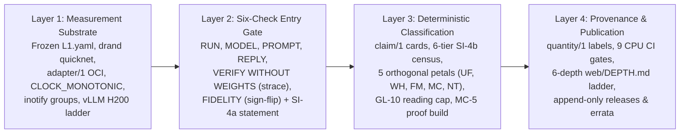
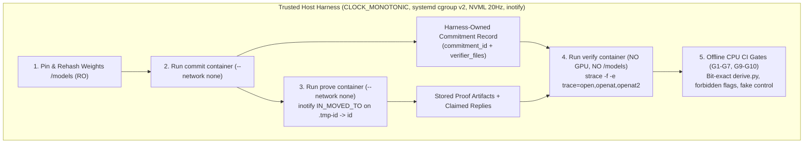
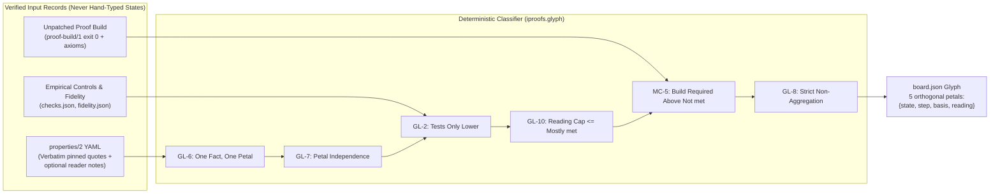

# Inference Proofs: Benchmarking Methodology and Deterministic Classification Criteria for Cryptographically Provable LLM Inference

**Technical Report (Methodology Monograph, Version 1.0)**  
**Authors:** AI Verification Observatory and Inference Proofs Contributors  
**Repository:** `https://github.com/ai-verification-observatory/inference-proofs`  
**Corpus Snapshot:** Inference Proofs Level 1 (`levels/L1.yaml` workload parameters frozen November 11, 2026, digest `sha256:6b7b0a069f46a5d6646e3768b57d0b77c01492ea12e80f639b59cb3d819aaa3e`; `releases/v1.0/board.json`, dated November 16, 2026; Request for Comments (RFC) specifications `RFC-0001` through `RFC-0018`, including pre-release Level 1 v1.0 hardening amendments through November 17, 2026)  
**Date:** November 19, 2026

> **About this paper.** This technical report documents and formally analyzes the benchmarking methodology, entry-gating controls, and classification criteria of *Inference Proofs* (v0.1 through Level 1 v1.0). Like a system monograph, each major section opens with the intuitive question and failure mode before giving exact mathematical definitions, schema invariants, and empirical measurements from Level 1 v1.0. Workload constants in `levels/L1.yaml` were frozen on November 11, 2026 before counted execution, while operational and display rules in `rfcs/0018-level-1-ladder.md` underwent documented pre-release v1.0 hardening through November 17, 2026 prior to final v1.0 publication; post-release rule changes increment the level to Level 2. Inference Proofs runs open-source provers as external containers and checks their outputs; it does not build, patch, or certify cryptographic proof systems.

---

## Abstract

Cryptographic proof systems for Large Language Model (LLM) inference now span small quantized neural networks through 400-billion-parameter Mixture-of-Experts (MoE) architectures. Yet self-reported performance and security numbers remain incomparable across systems: each paper selects its own model scale, quantization precision, timing boundary, checked-token coverage, and cryptographic soundness model. This paper formalizes and empirically audits the benchmarking methodology and classification criteria of **Inference Proofs** Level 1 (`RFC-0001` through `RFC-0018`). We organize the methodology into four interlocking layers: (1) an external Open Container Initiative (OCI) measurement substrate using frozen open-weights model rungs, distributed randomness beacon (`drand quicknet`) prompts for a fixed `512`-prompt plus `512`-greedy-reply request, release-group steady-state cost estimation, and saturated vLLM serving baselines; (2) an asymmetric six-check entry gate pairing harness-applied tampering controls (`MODEL`, `PROMPT`, `REPLY`) and kernel-level `strace` weight-independence checks (`VERIFY WITHOUT WEIGHTS`) with non-parametric paired sign-flip fidelity tests (`FIDELITY`), bounded explicitly by a constructive black-box impossibility observation (`systems/fake`) requiring a pinned publisher statement gate (`SI-4a`); (3) a non-aggregating classification rubric comprising machine-checkable claim cards (`claim/1`), an ordered six-tier non-run taxonomy (`SI-4b`), and deterministic table evaluation (`iproofs.glyph`) over human-extracted `properties/2` quotes across five orthogonal petals (*Integrity*, *Confidentiality* [provider weight hiding], *Fidelity*, *Formally verified*, *Trust assumptions*) governed by a uniform epistemic reading cap (`GL-10`) and unpatched proof-assistant rebuilds (`MC-5`); and (4) an auditable provenance and six-depth publication model enforced offline by nine Continuous Integration (CI) gates. Auditing 21 catalogued verifiable-inference systems under `SI-4b` yields 2 runnable Level 1 entrants (`9.5%`) and 19 excluded systems across distinct tiers: 5 non-cryptographic verification paradigms (`23.8%`), 2 differing cryptographic statements (`9.5%`), 6 missing standalone public verifiers (`28.6%`), 2 open-testing licence exclusions (`9.5%`), and 4 missing autoregressive LLM configurations (`19.0%`). Strictly 1 of 21 upstream systems (FlashProve on Llama 4 Maverick: `1,317×` whole-session cost multiple decomposing into `1,199×` generation plus `118×` commit and proving, clearing `SI-4a` via direct publisher quotes with `level_statement.reading = false`) ran unpatched, alongside SASH running at owner-authored unmerged Pull Request (PR) #36 (`4f4166729743`, disclosed as a provisional v1.0 exception after upstream `eb95bfa` refused slot 1) on Llama 3.1 8B (`54,453×` steady and `62,161×` whole-session cost multiple, clearing `SI-4a` via a `read as` statement reading with `level_statement.reading = true`), while 5 of 6 non-trivial statement petals across the two rows carry `GL-10` reading notes. Together, these results resolve order-of-magnitude headline discrepancies, diagnose six empirical failure post-mortems, audit estimator, cryptographic, and formal-verification edge cases, and establish concrete technical and institutional requirements for Level 2.

*Keywords:* provable inference, zero-knowledge machine learning, systems benchmarking, cryptographic classification criteria, non-parametric fidelity testing, formal verification, reproducibility

---

## Contents

1. [Introduction](#1-introduction)
   - 1.1 [The Comparability Crisis in Provable LLM Inference](#11-the-comparability-crisis-in-provable-llm-inference)
   - 1.2 [What Inference Proofs Measures and What It Refuses to Claim](#12-what-inference-proofs-measures-and-what-it-refuses-to-claim)
   - 1.3 [A Question-Driven Roadmap](#13-a-question-driven-roadmap)
   - 1.4 [Contributions and Search-Bounded Scope](#14-contributions-and-search-bounded-scope)
2. [Threat Model, Black-Box Impossibility, and Benchmarking Precedents](#2-threat-model-black-box-impossibility-and-benchmarking-precedents)
   - 2.1 [Relying Party, Untrusted Provider, and the External Verifier Boundary](#21-relying-party-untrusted-provider-and-the-external-verifier-boundary)
   - 2.2 [The Black-Box Impossibility Observation (`systems/fake`)](#22-the-black-box-impossibility-observation-systemsfake)
   - 2.3 [Cryptographic Foundations, Arithmetic Drift, and Comparative Benchmarks](#23-cryptographic-foundations-arithmetic-drift-and-comparative-benchmarks)
3. [Measurement Architecture and Execution Protocol](#3-measurement-architecture-and-execution-protocol)
   - 3.1 [Frozen Levels, Open-Weights Rungs, and Beacon-Seeded Requests](#31-frozen-levels-open-weights-rungs-and-beacon-seeded-requests)
   - 3.2 [External Container Contract (`adapter/1`), Provenance, and Nine CI Gates](#32-external-container-contract-adapter1-provenance-and-nine-ci-gates)
   - 3.3 [Release-Group Steady-State Estimation and Saturated Serving Ladders](#33-release-group-steady-state-estimation-and-saturated-serving-ladders)
   - 3.4 [Within-Rung Noise-Resistant Partial Order](#34-within-rung-noise-resistant-partial-order)
4. [The Six-Check Entry Gate](#4-the-six-check-entry-gate)
   - 4.1 [Tri-Valued Semantics and Session Eligibility (`RUN`)](#41-tri-valued-semantics-and-session-eligibility-run)
   - 4.2 [Adversarial Tampering Controls and Mandatory Honest Twins (`MODEL`, `PROMPT`, `REPLY`)](#42-adversarial-tampering-controls-and-mandatory-honest-twins-model-prompt-reply)
   - 4.3 [Weight-Independence Verification (`VERIFY WITHOUT WEIGHTS`)](#43-weight-independence-verification-verify-without-weights)
   - 4.4 [Non-Parametric Paired Sign-Flip Fidelity Testing (`FIDELITY`) and Teacher-Forced Diagnostics](#44-non-parametric-paired-sign-flip-fidelity-testing-fidelity-and-teacher-forced-diagnostics)
5. [Deterministic Classification Criteria](#5-deterministic-classification-criteria)
   - 5.1 [Machine-Checkable Claim Cards (`claim/1`)](#51-machine-checkable-claim-cards-claim1)
   - 5.2 [The Ordered Six-Tier Non-Run Eligibility Taxonomy (`SI-4b`)](#52-the-ordered-six-tier-non-run-eligibility-taxonomy-si-4b)
   - 5.3 [The Non-Aggregating Five-Petal Rubric and Epistemic Invariants](#53-the-non-aggregating-five-petal-rubric-and-epistemic-invariants)
   - 5.4 [Progressive-Depth Publication Architecture (`web/DEPTH.md`)](#54-progressive-depth-publication-architecture-webdepthmd)
6. [Level 1 v1.0 Empirical Instantiation and Operational Post-Mortems](#6-level-1-v10-empirical-instantiation-and-operational-post-mortems)
   - 6.1 [Ecosystem Census Across 21 Verifiable-Inference Systems](#61-ecosystem-census-across-21-verifiable-inference-systems)
   - 6.2 [Level 1 v1.0 Results: FlashProve and SASH](#62-level-1-v10-results-flashprove-and-sash)
   - 6.3 [Six Operational Failure Post-Mortems](#63-six-operational-failure-post-mortems)
7. [Governance, Conflicts of Interest, Limitations, and Level 2 Trajectory](#7-governance-conflicts-of-interest-limitations-and-level-2-trajectory)
   - 7.1 [Dual Conflicts of Interest and Epistemic Asymmetries](#71-dual-conflicts-of-interest-and-epistemic-asymmetries)
   - 7.2 [Engaging the Strongest Counter-Arguments](#72-engaging-the-strongest-counter-arguments)
   - 7.3 [Acknowledged Limitations](#73-acknowledged-limitations)
   - 7.4 [Conclusion and Level 2 Trajectory](#74-conclusion-and-level-2-trajectory)
- [Appendix A: Total Decision Tables for the Five Classification Petals](#appendix-a-total-decision-tables-for-the-five-classification-petals)
- [Appendix B: Mathematical and Statistical Definitions](#appendix-b-mathematical-and-statistical-definitions)
- [Appendix C: Frozen Experiment Provenance and Nine CI Gates](#appendix-c-frozen-experiment-provenance-and-nine-ci-gates)
- [References](#references)

---

## 1. Introduction

### 1.1 The Comparability Crisis in Provable LLM Inference

When a user queries a hosted Large Language Model (LLM) and receives output tokens, the user cannot tell whether the provider ran the advertised model, silently substituted a smaller model, quantized weights aggressively, or altered tokens after decoding `[RAC+26]`. Over the past decade, cryptographic verifiable inference has progressed from interactive arithmetic-circuit proofs (`SafetyNets`) and convolutional proofs (`zkCNN`) to PLONKish compilers (`ZKML`), commit-and-prove Succinct Non-Interactive Argument of Knowledge (SNARK) designs (`Artemis`), transformer protocols (`zkLLM`, `zkGPT`), Circle-STARK segment-grid provers (Singapore AI Safety Hub (SASH) `[SASH26]`), and hash-based Interactive Oracle Proof (IOP) libraries scaling to 400-billion-parameter Mixture-of-Experts (MoE) models (`FlashProve` `[RAC+26]`). Parallel verification lines pursue activation Locality-Sensitive Hashing (LSH) fingerprints (`TOPLOC`), refereed re-execution (`Verde`), statistical nondeterminism checks (`DiFR`), and hardware Trusted Execution Environment (TEE) attestations `[IP26]`.

Despite rapid engineering progress, published headlines remain incomparable. Unobserved measurement confounders routinely distort systems conclusions unless evaluations enforce explicit timing scopes, dispersion reporting, and end-to-end provenance `[IP26]`. Provable LLM inference compounds this problem because each prover checks a different relation. As documented in the Inference Proofs Product Requirements Document `[IP26]`, the first two Apache-2.0 LLM provers report incompatible figures:
- **SASH (`eb95bfa`, Llama 3.1 8B, W8A8 dense)** reports `1.251` positions/s in loop scope (`0.840` positions/s whole wall) over `4,608` positions (`4,096` prompt + `512` continuation), emitting `19.8 GB` proofs checked on a Central Processing Unit (CPU) in `119 s`, with `100` conjectured Fast Reed–Solomon Interactive Oracle Proof of Proximity (FRI) bits per segment and no weight-hiding claim `[IP26]` `[SASH26]`.
- **FlashProve (`9e2bdd8f`, Llama 4 Maverick, 400B/17B active, 4-bit integer MoE)** reports `111.23 ± 0.92` tokens/s of prefill in steady state at batch `24` (about `110` tokens/s `[RAC+26]`), checking one next token after a `1,024`-token window (`~18.78 MB`, `17–21 s` CPU verify), roughly `72×–94×` slower than vLLM FP8 prefill on Graphics Processing Unit (GPU) H100s, with Lean 4 soundness proved for a Lean verifier rather than C++ `cp_verify` `[RAC+26]` `[IP26]`.

Dividing `111` tokens/s by `1.251` positions/s mixes incompatible models, active parameter counts, quantization precisions, checked-token counts (`1` vs. `512`), autoregressive decoding, commitment amortization, and security statements `[IP26]`. Unlike Ethereum block proving (`Ethproofs`), where every zero-knowledge virtual machine (zkVM) proves one shared state-transition function, or unproved serving benchmarks (`MLPerf Inference`), provable LLM inference lacks a single shared relation `[IP26]`.

### 1.2 What Inference Proofs Measures and What It Refuses to Claim

In the spirit of FlashProve's explicit boundary between what is specified in Lean and what must be trusted `[RAC+26]`, Inference Proofs begins by drawing a hard line between what an external benchmark can establish and what it explicitly refuses to claim `[IP26]`.

*Figure 1.* Four-layer architecture of Inference Proofs Level 1 (`RFC-0001` through `RFC-0018`) `[IP26]`.

**Table 1.** *Scope Boundary: What Inference Proofs Measures and Checks vs. What It Refuses to Claim* `[IP26]`

| What Inference Proofs Measures and Checks | What Inference Proofs Explicitly Refuses to Claim |
|---|---|
| End-to-end cost of proving a fixed `512`-prompt + `512`-greedy-reply request as a multiple of saturated vLLM serving on the same open-weights model (`CO-1`–`CO-5`) | Cross-model ranking across different parameter scales or architectures (`OR-1`); a single composite "security + speed" score (`GL-8`); hardware-agnostic equivalence for CPU-only or non-H200 provers |
| Active verifier rejection under controlled tampering of weights (`P1`/`C3`), prompt (`C2`), and reply tokens (`C1`), plus `strace`-verified weightless verification (`CH-4`) | Cryptographic certification of soundness or zero knowledge; that passing empirical checks makes any prover secure or "provably safe" (`SI-4a`, `GL-2`) |
| Provider model-weight hiding claims in the *Confidentiality* (`weights_hidden`) petal (`WH-1`–`WH-6`) | **User prompt confidentiality or reply privacy** against a hosting provider or third-party verifier (explicitly out of scope in Level 1; `weights_hidden` covers provider weights only) |
| Paired non-parametric matched-prefix fidelity against rung-calibrated honest and damaged weight copies (`FI-3`–`FI-5`), plus non-gating teacher-forced agreement and KL divergence (`FI-10`) | That unproved scoring code (`FI-10`) is part of the proved relation (`FI-13`), or that matching leading prefix tokens prevents downstream drift on unexamined tail tokens |
| Deterministic table lookup (`iproofs.glyph`) over human-extracted verbatim publisher claims (`properties/2`), uniformly capped at `Mostly met` when reader inference is required (`GL-10`), plus unpatched proof-assistant rebuilds (`MC-5`) | End-to-end objectivity of human claim extraction, external semantic review of Lean definitions (`Q10`/`Q43`), equivalence between formal reference verifiers and compiled C++/CUDA binaries, or publisher endorsement |
| Bit-exact offline recomputation of every derived metric (`G4`), forbidden-flag audits (`G6`), and public disclosure of failed, refused, or replaced runs (`SE-3a`/`SE-3b`/`SE-5`) | Cross-operator reproducibility from `tier: reported` single-operator runs prior to `tier: replicated` verification, or verifier-side protection from `G6` command-line scanning against an untrusted provider |

### 1.3 A Question-Driven Roadmap

Readers approaching Inference Proofs from cryptography, machine learning systems, or AI governance typically ask six concrete questions. This paper is organized to answer each one directly:

1. **Why can empirical tests alone never prove a prover is sound?** Section 2 defines the relying-party threat model, formalizes the external verifier commitment boundary, and presents the constructive black-box impossibility observation (`systems/fake`) alongside comparative precedents (`Table 2`).
2. **How do we measure proving cost without batching bugs, timing-scope tricks, or cherry-picked prompts?** Section 3 specifies frozen levels, `drand quicknet` beacon prompts (including the three-freeze qualification `Q33`), the unpatched `adapter/1` container contract, `inotify` release-group steady-state estimation, saturated vLLM ladders, and the noise-resistant within-rung partial order.
3. **What must a system pass before entering a rung's leaderboard?** Section 4 details the closed tri-valued semantics of the six-check entry gate (`RUN`, `MODEL`, `PROMPT`, `REPLY`, `VERIFY WITHOUT WEIGHTS`, `FIDELITY`) and explains how `READ-1`–`READ-5` prevents spurious control failures on unread proof bytes.
4. **How do we compare heterogeneous security, privacy, fidelity, formal-verification, and trust claims without inventing a composite score?** Section 5 formalizes `claim/1` cards, the ordered six-tier non-run taxonomy (`SI-4b`), the five-petal rubric (`UF`, `WH`, `FM`, `MC`, `NT`) with its five invariants (`GL-6`, `GL-7`, `GL-8`, `GL-2`, `GL-10`) and unpatched formal-proof builds (`MC-5`), and the six-depth publication model (`web/DEPTH.md`).
5. **What happens when Level 1 actually runs on real provers and the broader ecosystem?** Section 6 reports the verified 21-system `SI-4b` census (`Table 3`), the complete Level 1 v1.0 measurements for FlashProve and SASH (`Table 4`) reconciling `1,317×` with FlashProve's `72×–94×` prefill headline, and six operational failure post-mortems (`Table 5`).
6. **Where are the conflicts of interest, counter-arguments, residual theorem limits, and Level 2 boundaries?** Section 7 audits the dual conflicts of interest (Claude/Anthropic drafting RFC-0018 and owner-authored SASH PR #36), engages the strongest counter-arguments, states five concrete limitations candidly, and defines the Level 2 trajectory.

### 1.4 Contributions and Search-Bounded Scope

To our knowledge, within the open verifiable-inference ecosystem catalogued in Inference Proofs Level 1 (`web/_data/facts.json`, snapshot November 16, 2026) `[IP26]`, no prior open benchmark combines saturated-serving cost multiples, harness-applied adversarial tampering and weight-independence controls, non-parametric paired sign-flip fidelity gating, and a non-aggregating five-axis classification rubric with unpatched formal-proof rebuilds for end-to-end LLM inference provers. Rather than claiming wholesale novelty for every component, Level 1 adapts established methodological ideas from four adjacent domains: concurrency-saturated serving normalization (as in MLPerf Inference), `100`-bit and `128`-bit concrete soundness thresholds (as in Ethereum zkEVM security milestones), end-to-end operator and transformer evaluation baselines from verifiable-ML system suites (`ZKML`, `ZKTorch`, `zkPyTorch`, `DeepProve`, `opML`, as catalogued in `facts.json`), and construct-validity, documentation-transparency, and black-box audit-limitation principles from AI auditing practice `[IP26]`. To maintain strict source provenance, formal bibliographic citations in this monograph are restricted exclusively to the three locally acquired, hash-pinned primary artifacts inspected in full: the Inference Proofs specification, harness, and result repository `[IP26]`, the 23-page FlashProve technical report `[RAC+26]`, and the pinned SASH repository records `[SASH26]`.

Within that scope, this paper makes four contributions:
1. **Formal Specification of a Four-Layer Benchmarking Methodology:** We synthesize `RFC-0001` through `RFC-0018` and the reference implementation (`harness/src/iproofs/`) into a self-contained mathematical and operational specification covering measurement, entry gating, classification, and progressive-depth disclosure `[IP26]`.
2. **Constructive Separation of Empirical Testing from Cryptographic Claims:** Using `systems/fake` (`exp-v1-ci-validation-and-fake`), we formalize why black-box tests can only falsify implementations (`GL-2`) and document the exact epistemic boundary enforced by `SI-4a`, `GL-10`, and `MC-5` `[IP26]`.
3. **Disaggregated Ecosystem Census and v1.0 Instantiation:** We audit all 21 catalogued verifiable-inference systems under `SI-4b` (2 runnable systems and 19 non-run systems split across 5 non-cryptographic paradigms, 2 differing cryptographic statements, 6 missing standalone public verifiers, 2 licence exclusions, and 4 missing autoregressive LLM configurations), disclosing upfront that strictly 1 of 21 upstream systems (FlashProve) ran unpatched while SASH ran at owner-authored unmerged PR #36, and report complete v1.0 measurements (`exp-v1-serving-baselines`, `exp-v1-flashprove-maverick`, `exp-v1-sash-llama31-8b`, `exp-v1-fidelity-and-tf`, `exp-v1-lean-proof-build`) with session ranges, sample sizes, verifier resources, and six operational failure post-mortems `[IP26]`.
4. **Transparent Governance, Mathematical Edge-Case, and Failure-Boundary Audit:** We explicitly analyze estimator and semiorder pathologies, dual institutional and authorial conflicts of interest, publisher-stated Lean theorem limits (`lean/THEOREM.md`), SASH's `Fixed` gadget-switch threat-model gap, stakeholder exclusion burdens, and the empirical sparsity of Level 1 v1.0 to chart concrete technical and institutional requirements for Level 2 `[IP26]` `[RAC+26]` `[SASH26]`.

---

## 2. Threat Model, Black-Box Impossibility, and Benchmarking Precedents

### 2.1 Relying Party, Untrusted Provider, and the External Verifier Boundary

**Intuition.** Imagine auditing a cloud inference provider that claims to serve a 400-billion-parameter model. The provider holds the model weights (which may be proprietary in production, though open in Level 1 so the benchmark can run every prover on identical weights) and executes on GPU hardware the client cannot inspect. The client (relying party) knows only a short public commitment $C_W$ published in advance for the target weights $W$, the prompt $x$, and the returned reply $y$. To check $y$ without downloading hundreds of gigabytes of weights or re-executing the forward pass on GPUs, the client runs a standalone CPU verifier $V(C_W, x, y, \pi) \in \{\text{accept}, \text{reject}\}$ on a proof $\pi$ returned by the provider `[RAC+26]` `[IP26]`.

This threat model implies two non-negotiable architectural invariants (`AGENTS.md` Rule 6, `RFC-0005`): first, **the commitment $C_W$ and static verifier files supplied to $V$ must originate from the relying party's (harness's) own record of the offline `commit` phase, never from files transmitted alongside the proof $\pi$** `[IP26]`. If a verifier reads its verifying key or weight root out of the proof archive produced during `prove`, a cheating provider can substitute a tiny proxy model $W'$, commit $W'$ on the fly, and output a valid proof of $W'$ that the verifier blindly accepts. Second, **any soundness-critical configuration parameter (such as gadget-skipping flags) must either be cryptographically bound inside harness-owned $C_W$ or actively rejected by the standalone verifier $V$ itself**: an external relying party never sees an untrusted provider's CLI arguments, so benchmark-side command-line auditing (CI Gate `G6`) protects benchmark bookkeeping rather than closing the untrusted-provider threat model. As Sections 6.1 and 6.2 demonstrate, violating the external commitment boundary is the largest architectural barrier across published zkML systems (`6/21`), while reading unauthenticated gadget switches from the proof artifact creates an active relying-party caveat in Level 1 v1.0's SASH adapter (`systems/sash/properties.yaml`, where `Fixed` gadget switches are read from the untrusted proof rather than committed inside `C_W`) `[IP26]` `[SASH26]`.

### 2.2 The Black-Box Impossibility Observation (`systems/fake`)

**Intuition.** A tempting shortcut when designing an inference-proof benchmark is to rely purely on empirical black-box tests: perturb the weights, perturb the prompt, perturb the reply, confirm with `strace` that the verifier opens no weight files, and check that the replies match the target model's outputs. If a prover passes all six checks, is it a real cryptographic proof system?

**Proposition (Black-Box Indistinguishability of Keyed MACs from Inference Proofs).** *Consider the six empirical entry checks of Level 1 (`RUN`, `MODEL`, `PROMPT`, `REPLY`, `VERIFY WITHOUT WEIGHTS`, `FIDELITY`) executed as black-box container invocations under `adapter/1`. There exists a trivial non-proof system `systems/fake` that satisfies all six checks on every trial whenever it executes genuine inference during `prove`, while providing zero cryptographic soundness against a dishonest prover* `[IP26]`.

*Constructive demonstration (`exp-v1-ci-validation-and-fake`).* Implement `systems/fake` as follows `[IP26]`:
1. During `commit(W)`, hash the weight files to produce `commitment_id` $= H(W)$ and store $H(W)$ in the harness commitment record.
2. During `prove(W, x)`, run genuine greedy inference on $W$ to produce honest reply $y$, compute $k = H(W)$ from the mounted `/models` directory, and emit the 32-byte tag $\pi = \text{HMAC-SHA256}_k(x \,\|\, y)$ (using the weight hash as a symmetric Keyed-Hash Message Authentication Code (HMAC) key).
3. During `verify(C_W, x, y, \pi)` (running offline with no GPU and no `/models` mount), recompute $\pi' = \text{HMAC-SHA256}_{C_W}(x \,\|\, y)$ using only the harness-supplied `commitment_id` $C_W$ and accept iff $\pi' = \pi$.

Evaluate `systems/fake` against every empirical gate:
- `RUN`: completes 3 clean sessions with zero weakening flags.
- `MODEL` (`P1`, `C3`): proving with perturbed $W' \ne W$ computes $k' = H(W') \ne C_W$, so `verify` rejects `P1` in 3/3 trials; verifying an honest proof against $C_{W'}$ also mismatches and rejects `C3` in 3/3 trials.
- `PROMPT` (`C2`) and `REPLY` (`C1`): flipping any token in $x$ or $y$ invalidates the HMAC tag in 3/3 trials.
- `VERIFY WITHOUT WEIGHTS` (`CH-4`): `verify` reads only $C_W$, $x$, $y$, and $\pi$, opening zero model files under `strace`.
- `FIDELITY` (`FI-3`–`FI-5`): because `prove` honestly ran $W$, the output replies match the reference model verbatim.

Yet a dishonest provider holding $C_W$ (which is public!) can forge a valid tag $\pi$ for any garbage reply $y^*$ in microseconds without ever running $W$. Running `systems/fake` end-to-end in CI Gate `G10` (`exp-v1-ci-validation-and-fake`) proves constructively that **empirical testing alone can falsify broken implementations (`GL-2`), never establish cryptographic soundness** `[IP26]`, reflecting the broader limit that black-box input-output testing alone cannot establish rigorous internal guarantees. Inference Proofs therefore adds an explicit non-empirical ranking gate (`SI-4a`, `OR-2`): a row that passes all six checks enters ranking only if its publisher states at the pinned commit that `accept` implies the reply is the committed model's greedy output, paired with a separate five-petal classification of the publisher's security claims and formal proofs `[IP26]`. Crucially, `SI-4a` introduces an explicit **residual publisher-attestation trust assumption**: the benchmark relies on public accountability for pinned publisher statements (and human reading extraction when publisher prose is indirect under `read as`), not on an independent cryptographic security proof audit by the benchmark team.

### 2.3 Cryptographic Foundations, Arithmetic Drift, and Comparative Benchmarks

Modern scalable inference provers avoid trusted setups by combining Interactive Oracle Proofs (IOPs) and hash-based proximity testing (Zero-Knowledge Scalable Transparent Argument of Knowledge (zk-STARK) constructions and code-switching schemes such as WHIR) with the Fiat–Shamir transformation analyzed in the Random Oracle Model (ROM) `[RAC+26]` `[SASH26]`. Three domain distinctions directly motivate Inference Proofs' classification rules:
1. **Conjectured vs. Proved Soundness, Fiat–Shamir Compilation, and Bit-Security Floors:** Interactive IOP soundness does not automatically transfer to non-interactive Fiat–Shamir compiled proofs, and heuristic parameter accounting cannot be equated with a proved concrete ROM or Quantum Random Oracle Model (QROM) bound `[IP26]` `[RAC+26]`. Similarly, language-binding soundness (as proved in FlashProve's `HasIndexBinding`, `lean/LIMITS.md`) differs formally from extractable knowledge soundness `[RAC+26]`. These distinctions directly motivate `UF-6` (separating proved from conjectured bounds) and Level 1's concrete security thresholds (`100` bits for `Mostly met` under `UF-8` and `128` bits for `Met` under `UF-7`, exceeding standard `112`-bit minimum key-strength floors) `[IP26]`, while Section 5.3 critiques Level 1's raw-exponent evaluation rule over quadratic collision terms.
2. **Formal Verification Reach:** Mechanized proof-assistant verification of succinct arguments spans linear-PCP SNARKs, algebraic intermediate representations, Rust-to-Lean pipelines, and FlashProve's Lean 4 soundness and zero-knowledge theorems `[RAC+26]`. However, a gap persists between proving an abstract protocol or reference verifier and verifying compiled GPU/CPU binaries `[RAC+26]`, motivating the distinction between `protocol_and_statement` and `verifier_run` in `MC-6` `[IP26]`.
3. **Integer Quantization vs. Floating-Point Nondeterminism:** Arithmetic proof systems execute deterministic integer or fixed-point models, whereas GPU serving exhibits floating-point non-associativity across batch layouts `[RAC+26]` `[IP26]`. Allowing loose numerical tolerances invites covert model substitution or output-bias attacks, requiring exact-match reply checks paired with calibrated fidelity testing against the publisher's reference precision `[IP26]`.

Beyond unproved serving benchmarks (MLPerf Inference) and single-relation block-proving ladders (Ethproofs), Inference Proofs Level 1 sits conceptually between two additional practices: verifiable-ML system suites (`ZKML`, `ZKTorch`, `zkPyTorch`, `DeepProve`, `opML`, each catalogued in `web/_data/facts.json` `[IP26]`) that evaluate individual provers on bespoke model subsets without standardized adversarial harness controls, and AI assurance and benchmark-validity frameworks that emphasize verifiable-claim mechanisms, construct validity, audit access limits, and reproducible reporting without defining cryptographic prover execution contracts. Specifically, Level 1 *adapts* concurrency-saturated serving ladders, concrete `100`/`128`-bit security thresholds, and structured transparency reporting `[IP26]`, while its *architectural contribution* is integrating external-commitment adversarial tampering (`C1`–`C3`, `P1`), `strace` weight-independence checks (`CH-4`), calibrated paired sign-flip fidelity gating (`FI-3`–`FI-5`), and a non-aggregating five-petal rubric with unpatched formal-proof rebuilds (`MC-5`) into one reproducible OCI harness for end-to-end LLM provers. Table 2 contrasts these five regimes conceptually (with formal citations restricted to the locally acquired primary benchmark specification `[IP26]`).

**Table 2.** *Conceptual Structural Comparison of Five Benchmark and Audit Regimes (MLPerf Inference, Ethproofs / zkEVM, Verifiable-ML System Suites, AI Audit & Benchmark-Validity Frameworks, and Inference Proofs Level 1)* `[IP26]`

| Dimension | MLPerf Inference (serving paradigm) | Ethproofs / zkEVM (block-proving paradigm) | Verifiable-ML System Suites (`ZKML`, `ZKTorch`, `DeepProve` in `facts.json`) | AI Audit & Benchmark-Validity Frameworks (assurance paradigm) | Inference Proofs Level 1 `[IP26]` |
|---|---|---|---|---|---|
| **Verified relation** | None (unproved serving) | Single canonical relation (Ethereum block) | Heterogeneous per system (CNN, edge models, or LLM prefill/layers) | Normative auditability and validity checklists; no prover relation | Heterogeneous per system; pinned `claim/1` card + `SI-4a` required |
| **Workload & anti-gaming** | Fixed datasets and scenarios; closed vs. open divisions | Live Ethereum mainnet blocks | Author-selected model checkpoints and test prompts | Construct-validity and documentation audits | Frozen open-weights rungs; fixed `p512-o512` greedy request; `drand quicknet` beacon prompts |
| **Baseline normalization** | Absolute latency or throughput per hardware | Proving latency and cost per block | Raw proving time or ratio vs. author-chosen unproved run | Qualitative transparency and governance scoring | Cost multiple vs. saturated vLLM serving ladder on fewest H200 GPUs (`CO-4`–`CO-5`) |
| **Numerical fidelity gate** | Fixed accuracy target (e.g., 99% of FP32 reference) | Exact deterministic VM state match | Paper-specific quantization error or single-run accuracy check | Evaluates construct validity of metrics | Paired sign-flip test (`FI-4`) vs. rung-calibrated damaged bar + non-gating `FI-10`/KL |
| **Adversarial controls** | None | Valid block proof verification | Self-reported unit tests; no external commitment boundary | Critiques black-box audit sufficiency | Harness-applied controls (`C1`–`C3`, `P1`) with honest twins + `strace` (`CH-4`) + `SI-4a` |
| **Property classification** | None | Soundness milestones (`100`/`128`-bit) | Informal narrative security claims | Structured claim-verification mechanisms | Non-aggregating five-petal rubric + `GL-10` reading cap + `MC-5` proof rebuild |
| **Ranking scope** | Per scenario and division | Across provers on shared blocks | Direct author-reported comparison tables | Warns against aggregate universal leaderboards | Strictly within one model rung (`OR-1`–`OR-6`); never across rungs; never by glyph |

---

## 3. Measurement Architecture and Execution Protocol

### 3.1 Frozen Levels, Open-Weights Rungs, and Beacon-Seeded Requests

**Intuition.** If benchmark authors can tweak prompt lengths, sampling rules, or passing thresholds after seeing how a specific prover behaves, the benchmark drifts into post-hoc tuning. Conversely, if systems select their own prompts, provers can overfit arithmetic bounds or lookup ranges to easy inputs. Inference Proofs resolves both risks by freezing every methodological rule into a versioned **level** before any counted run begins, and drawing prompts from a public randomness beacon produced *after* the freeze commit `[IP26]`.

**Formal specification (`LV-1`–`LV-3`, `PR-1`–`PR-3`) and freeze-vs.-hardening timeline.** Level 1 separates **frozen workload constants** from **pre-release specification hardening** prior to initial v1.0 publication. All four git commits to `levels/L1.yaml` occurred on **November 11, 2026** (`a57124b`, `6f89f42`, `a082b2c`, `0032bcc`, finalizing content digest `sha256:6b7b0a069f46a5d6646e3768b57d0b77c01492ea12e80f639b59cb3d819aaa3e`), locking the model rungs, `512 + 512` greedy request geometry, session counts $N$, serving-ladder structure, and `drand` beacon round before any counted v1.0 run began `[IP26]`. During v1.0 execution (November 11–17, 2026), `rfcs/0018-level-1-ladder.md` received documented pre-release rule-hardening and disclosure amendments (`CH-4a` offline CPU `reverify`, `SE-3a`/`SE-3b` slot replacement and eligibility, `PR-2` three-freeze qualification, `FI-9`/`FM-5` batched-reference fidelity cap, `MC-4a` stopped-build handling, `GL-10`/`GL-11` reading caps, and `SI-3` statement disclosure) in direct response to live operational failures (Table 5) prior to publishing v1.0. Once a level's initial release is published, `LV-1` enforces post-release immutability: subsequent releases (`v1.n`) strictly append new runs under the published Level 1 rules, while normative rule modifications increment the level to `L2` `[IP26]`. Level 1 defines three open-weights model rungs ordered from largest to smallest (`LV-2`), each with a fixed session request count $N$ and per-session USD spend ceiling:
1. **Llama 4 Maverick 17B-128E Instruct** (`400B` total / `17B` active MoE parameters; $N = 120$ replies/session; cap `$120`).
2. **Llama 3.1 8B Instruct** (`8.03B` dense parameters; $N = 5$ replies/session; cap `$40`).
3. **GPT-2** (`124M` stated parameters; `137,022,720` total safetensors elements including 12 causal-mask buffers documented in `errata.json` under `Q31`; $N = 5$ replies/session; cap `$40`) `[IP26]`.

Every system on every rung receives the identical request specification `p512-o512`: `512` prompt tokens and `512` greedy (`temperature = 0`, deterministic argmax) output tokens, with `ignore_eos: true` and `every_reply_token_checked: true` (`PR-1`) `[IP26]`. Prompts are deterministically sliced from a hash-pinned public text corpus (`sha256:cedd5c41...`) by `beacon-window/1`, seeded using the first 8 big-endian bytes of the **drand `quicknet`** distributed randomness beacon (`levels/L1-beacon.json`, 3-second rounds) immediately following the final November 11 freeze commit (`round 33867489`, randomness `f12fe018...`, fetched from two independent relays requiring byte-equality and $\text{randomness} = \text{SHA-256}(\text{signature})$) `[IP26]`. Crucially, the three counted session slots (slots 1, 2, and 3) draw **disjoint prompt slices** from this stream (confirmed by distinct `prompt_set_digest` values across slots 1–3 on both Llama 4 Maverick [`63b7c7017dc6`, `2b49624c9d3f`, `b5a561c10228`] and Llama 3.1 8B [`616727b6a2e1`, `f80d188b60b9`, `ed166a29ad11`]): this maximizes fidelity sample size ($3N$ distinct prompts) while causing 3-session timing spreads at small $N$ ($N = 5$) to combine prompt-slice heterogeneity with host-level jitter (decomposed empirically in Section 6.2).

**Three-freeze qualification (`PR-2`/`Q33`) and Level 2 future-round pre-commitment.** Amended on November 15, 2026 during pre-release hardening, `PR-2` explicitly qualifies the beacon's unpredictability guarantee: because git commit timestamps reflect the committer's local clock, the property "nobody chooses the round" holds strictly for a *single* freeze `[IP26]`. Level 1 underwent three freezes on November 11, 2026 (`6f89f42`, `a082b2c`, `0032bcc`) while workload constants were finalized, with GitHub push timestamps trailing each commit by 2 seconds and every counted v1.0 run pinned to the third freeze digest (`levels/L1-beacon.json`) `[IP26]`. Recording all three freezes preserves auditability but does not cryptographically preclude freeze-commit grinding. For Level 2, we specify an **externally timestamped future-round `drand` pre-commitment protocol**: publish a signed git tag (anchored in an external transparency log such as Sigstore Rekor or an RFC 3161 timestamp authority) containing the frozen `levels/L2.yaml` SHA-256 digest together with a *future* target `drand quicknet` round $R_{\text{target}}$ scheduled at least 200 rounds ($\ge 10$ minutes) after the external timestamp, and reject any run whose beacon round differs from $R_{\text{target}}$.

### 3.2 External Container Contract (`adapter/1`), Provenance, and Nine CI Gates

**Intuition.** Measuring a prover from inside its own Python or Rust driver invites subtle timing-scope leaks (excluding serialization, pre-loading caches, or reporting peak inner-loop throughput). Inference Proofs therefore treats every prover as an untrusted black-box OCI container whose timing, memory, GPU telemetry, filesystem access, and proof-release events are observed strictly from the host harness `[IP26]` `[IP26]`.

*Figure 2.* External container contract (`adapter/1`) and host-side measurement boundary separating prover execution from verifier commitment supply (`RFC-0005`, `RFC-0011`, `RFC-0013`) `[IP26]`.

**Normative rules (`RFC-0005`, `RFC-0011`, `RFC-0012`, `RFC-0013`, `RFC-0014`).**
- **Unpatched containers (`AGENTS.md` Rule 1) and Level 1 v1.0 provisional exception:** Adapters are required to wrap upstream prover repositories at full 40-hex git commit hashes with zero source patches and zero undocumented parameters. In Level 1 v1.0, uniform unpatched enforcement was not achieved across both ranked rungs: strictly FlashProve (`9e2bdd8ff5bf`) ran an unpatched upstream commit, whereas SASH ran at owner-authored unmerged PR #36 (`4f4166729743`) as a disclosed provisional v1.0 exception after upstream commit `eb95bfa` refused slot 1 (audited institutionally in Sections 7.1 and 7.4). Containers expose five file-based subcommands (`info`, `setup`, `commit`, `prove`, `verify`) under `--network none`, `--read-only`, `--cap-drop ALL`, pinned CPU and Non-Uniform Memory Access (NUMA) masks, and read-only `/models` mounted exclusively into `commit` and `prove`, never into `verify` `[IP26]`.
- **Host-side monotonic timing and telemetry (`RFC-0011`):** Every timestamp originates from one host `CLOCK_MONOTONIC` clock. Container-slice `systemd` cgroup v2 counters record post-exit `memory.peak` and `cpu.stat`, NVIDIA Management Library (NVML) telemetry samples GPU utilization and memory at `20 Hz` (marking any run whose inter-sample gaps exceed `150 ms` on more than `5%` of samples as `degraded`), and a Linux `inotify` watcher (`IN_MOVED_TO`) timestamps atomic proof-directory renames from `.tmp-<proof_id>` to `<proof_id>` `[IP26]`.
- **Self-describing quantities (`RFC-0012`):** Every stored numeric value is a `quantity/1` record carrying `{value, unit, scope, grade, tier, source, null_reason}`, ensuring no bare unlabelled figure can enter `results/` or `releases/` `[IP26]`.
- **Nine offline CPU CI gates (`RFC-0013`, `exp-v1-ci-validation-and-fake`):** Every release must pass nine deterministic CPU gates (`G1`–`G7`, `G9`–`G10`; summarized in Appendix C), including JSON Schema validation (`G1`), full-commit and SHA-256 pin verification (`G2`), bit-exact recomputation of every derived metric via `iproofs.derive` (`G4`, `DER-1`), command-line forbidden-flag auditing preventing weakening flags such as `--unsound-skip-*` outside negative controls (`G6`, `POL-1`), secret and local-path hygiene (`G9`, `SEC-10`), and end-to-end execution of `systems/fake` (`G10`) `[IP26]`.

### 3.3 Release-Group Steady-State Estimation and Saturated Serving Ladders

**Intuition.** Measuring per-reply proving cost naively by dividing total wall-clock time by $N$ mixes one-time model commitment and startup overhead with steady-state marginal proving cost. Conversely, measuring steady state by dropping only the first single proof (`RFC-0004` `INV-SCOPE-5`) breaks catastrophically when a prover emits proofs in batches: in v0.1, FlashProve released 24 proofs simultaneously every `~171 s`, so dropping only proof 1 left 23 proofs from batch 1 inside the steady window and miscounted `119` steady replies where only `96` were actually produced (`5.746` vs. `7.128` GPU-s/request, a 20% downward distortion) `[IP26]`.

**Release-group steady-state estimator (`CO-1`–`CO-3`, `CO-6`, `AD-4`) and mathematical boundary analysis.** Level 1 replaces single-proof warm-up exclusion with host-observed **release groups** `[IP26]`:
1. Order the $N$ `inotify` atomic-rename timestamps $t_{(1)} \le \dots \le t_{(N)}$ and partition consecutive releases separated by at most `group_gap_s = 1.0 s` into $G$ release groups $g = 1, \dots, G$, each of size $n_g$ and end timestamp $t_g = \max_{i \in g} t_{(i)}$.
2. Let $g_{\text{bound}}$ be the number of bound GPUs, and let $T_{\text{gen}}$ be the optional externally marked generation-phase GPU-seconds (`AD-4`, when autoregressive decoding runs as a distinct marked phase prior to batched proving; $T_{\text{gen}} = 0$ when generation is coupled inside proving). Define the session's **steady-state cost per reply** $m$ (in GPU-s/reply):
   $$m = \frac{(t_G - t_1)\, g_{\text{bound}}}{\sum_{g=2}^{G} n_g} + \frac{T_{\text{gen}}}{N}.$$
3. Define each later group's per-reply interval $\Delta_g = (t_g - t_{g-1}) / n_g$ for $g \in \{2, \dots, G\}$, with median $\tilde{\Delta} = \operatorname{median}_{g \ge 2} \Delta_g$. A session achieves **steady state** (`steady = true`) iff:
   $$G - 1 \ge 3 \quad (\text{`min\_later\_groups`}) \quad \text{and} \quad \max_{g \ge 2} \frac{|\Delta_g - \tilde{\Delta}|}{\tilde{\Delta}} \le 0.05 \quad (\text{`tolerance`}).$$
   Otherwise `steady = false` with closed diagnostic reason `too few groups` or `uneven groups`.
4. Independently, **whole-session cost per reply** (`CO-1`) measures total GPU-seconds from the start of `commit` to the $N$-th proof release divided by $N$ (excluding read-only weight caching before `commit`), and `CO-7` decomposes whole-session cost into its externally observed Generation, Commit, and Proving parts `[IP26]`.

*Mathematical critique of `CO-2`, `CO-3`, and `AD-4` (with Level 2 repairs).* Auditing these frozen Level 1 definitions exposes two boundary pathologies (derived formally in Appendix B item 5). First, **fixed `1.0 s` single-linkage chaining collapse**: whenever a fast future prover releases consecutive individual proofs faster than `1.0` proof/s ($t_{(i+1)} - t_{(i)} \le 1.0\text{ s}$ for all $i$), single-linkage clustering chains all $N$ releases into a single group ($G = 1$), forcing `steady = false` (`too few groups`) even when marginal per-proof latency is perfectly constant. Conversely, as Section 6.2 confirms on FlashProve slots 2–3, a single `+7–8%` batch tail outlier among four batches trips the hard `5%` maximum-relative-deviation cliff even when whole-session cost varies by `< 1.8%`. Second, **`AD-4` unverified phase boundary**: dividing un-warmed $T_{\text{gen}}$ by $N$ mixes first-reply decoding startup into the steady estimator and trusts an adapter-emitted phase marker inside the `prove` container rather than a host-enforced transition. Level 2 repairs both flaws by replacing fixed `1.0 s` clustering with scale-adaptive inter-arrival gap detection (verified against explicit batch-size declarations when $t_{(i+1)} - t_{(i)}$ is bimodal, and falling back to individual releases when unimodal) and by enforcing host-isolated `generate` and `prove` container invocations whenever `AD-4` applies.

**Saturated serving baseline (`CO-4`, `CO-5`, `RFC-0015` `SRV-6`, `exp-v1-serving-baselines`), saturation validation, and hardware-accounting scope.** Reporting raw GPU-seconds per reply obscures how expensive the underlying model is to serve without proofs. Level 1 normalizes proving cost against a **saturated serving baseline** on the same open-weights model: pinned **vLLM `0.32.0`** (`docker.io/vllm/vllm-openai@sha256:befccf0e...`, build commit `5df63a7203cd`, `max_num_batched_tokens = 8192`, `vllm serve` with `--max-model-len 1024` and `--tensor-parallel-size` `4` for Maverick FP8 or `1` for Llama 3.1 8B BF16) serving the publisher's reference weights on the fewest NVIDIA H200 GPUs (`143,771 MiB`, driver `580.178.04`, CUDA `13.0`) that hold the model across a concurrency ladder $c \in \{1, 2, 4, 8, \dots, 1024\}$ (1 warm-up batch plus 3 timed batches per concurrency rung, using per-batch cache salting across `4,096` beacon prompts to defeat prefix caching) `[IP26]`. Let $r_c$ denote span reply throughput per GPU (replies/GPU-s) at concurrency $c$, and define full-load concurrency $c^*$ as the smallest $c$ satisfying:
$$r_{c^*} \ge 0.95 \max_{c'} r_{c'}.$$
If $c^*$ lands on the top rung (`1024`), the baseline is rejected as `not saturated` so no prover benefits from an under-loaded denominator `[IP26]`. With baseline cost per reply $b = 1 / r_{c^*}$ (GPU-s/reply), a row's **steady multiple** is $M_{\text{steady}} = \bar{m} / b$ (when all 3 sessions are steady) and its **whole-session multiple** is $M_{\text{session}} = \bar{s} / b$ (surfaced uniformly across rows per `CO-5`/`Q29`, while USD/reply multiplies GPU-seconds by a pinned H200 hourly rate snapshot, `$5.345/GPU-hr` as of November 8, 2026) `[IP26]`.

*Empirical saturation validation and hardware-accounting boundaries.* Inspecting the stored vLLM ladders (`results/v1.0/ref-serve/`, full 3-batch curves in Appendix C Table C.1) reveals three methodological boundaries. First, **threshold slack and saturation peaking**: selecting $r_{c^*} \ge 0.95 \max r_{c'}$ admits up to $1/0.95 - 1 = 5.26\%$ upward slack in $b$ (shifting multiples downward by up to $5.0\%$). On Llama 4 Maverick (`4×H200 FP8`), throughput peaks sharply at `c* = 512` (`5.21276` replies/GPU-s, 3-batch range `5.20030–5.22148`, **`0%` slack**) and drops `18.1%` at `c = 1024` (`4.26784`, ratio `r_512 / r_1024 = 1.2214`) because the `607,516`-token KV cache holds only `593` of `1,024` concurrent requests, queuing the remainder (leaving the narrow `c ∈ (512, 593]` interval unprobed). On Llama 3.1 8B (`1×H200 BF16`), `c* = 256` (`23.19567`, range `23.16556–23.23020`, `95.58%` of `r_512 = 24.26947`) empirically realizes **`4.63%` slack** relative to peak `r_512` (`r_512 / r_1024 = 1.0499`, KV cache `886/1,024`); normalizing against peak `r_512` would raise SASH's steady multiple from `54,453×` to `56,974×`. Second, **uniform H200 GPU scope and linear per-GPU billing**: `CO-5`'s $g_{\text{bound}}$-weighted multiple is valid strictly for **homogeneous NVIDIA H200 GPU provers** ($g_{\text{bound}} \ge 1$) under linear per-GPU pricing (treating a `4×H200` NVLink TP4 serving node as `4×` a `1×H200` prover node without multi-GPU interconnect premiums). Literal application yields degenerate zero cost ($m = 0$) for a CPU-only prover ($g_{\text{bound}} = 0$) and unit-mismatched ratios on non-H200 accelerators. Third, **relying-party omission**: ranking solely by provider GPU-seconds excludes client CPU verification latency, verifier RAM, and gigabyte proof egress, creating a provider-to-client cost-shifting incentive analyzed in Section 6.2.

### 3.4 Within-Rung Noise-Resistant Partial Order

**Intuition.** Cloud GPU hosts exhibit run-to-run variance of several percent `[IP26]`. Sorting provers by raw floating-point means turns thermal noise into false leaderboard churn, while ranking an 8B prover beside a 400B MoE prover invites invalid cross-scale extrapolation.

**Partial-order rule (`OR-1`–`OR-6`) and eligibility asymmetry.** Ranking is computed strictly *inside* one model rung (`OR-1`); rows are never ranked across rungs, and the five-petal glyph never shifts rank (`GL-4`) `[IP26]`. Only rows that pass all six checks (`passed`), carry a publisher-stated security level (`OR-2`, `board.py` L63 and L592–606), and satisfy the pinned statement gate (`SI-4a`) enter ranking. While `OR-2` already excludes provers whose publisher states no security level at all (`NO_SECURITY_LEVEL`), coupling `OR-2` with `GL-4` leaves an explicit **security-vs.-fidelity eligibility asymmetry**: `OR-2` enforces a mandatory empirical `FIDELITY` floor (`held`), yet imposes **no minimum bit-security floor**, allowing a system whose stated soundness bound grades `Not met` (for example, `< 80` proved bits, `< 100` conjectured bits, or `adversary == weaker`) to enter and win a rung purely on proving speed if it carries a matching `SI-4a` sentence (closed without scalar aggregation in Level 2, Section 7.4). Among ranked rows $A$ and $B$ on the same rung, $A$ strictly precedes $B$ ($A \prec B$) iff (`OR-3`, `board.py` L91–104):
1. Both $A$ and $B$ achieved steady state across all 3 counted sessions, **and**
2. $\bar{M}_A \le (1 - 0.10)\,\bar{M}_B = 0.90\,\bar{M}_B$ (`order.margin = 0.10`), **and**
3. $\max_{j \in \{1,2,3\}} m_{A,j} < \min_{j \in \{1,2,3\}} m_{B,j}$ (strictly non-overlapping 3-session steady spreads);
**or** $A$ achieved steady state across all 3 sessions and $B$ did not; **or** neither $A$ nor $B$ achieved steady state across all 3 sessions and $A$ satisfies the same `10%` mean margin ($\bar{s}_A \le 0.90\,\bar{s}_B$) and strictly non-overlapping 3-session spread ($\max_{j \in \{1,2,3\}} s_{A,j} < \min_{j \in \{1,2,3\}} s_{B,j}$) over whole-session cost per reply (`RFC-0018` L331, `harness/src/iproofs/board.py` L91–104). Under `OR-4` (`board.py` L118–123), each ranked row's integer position is computed deterministically as $\operatorname{pos}(X) = 1 + |\{Y : Y \prec X\}|$ (one plus the number of ranked rows placed strictly above it, breaking equal positions alphabetically under `OR-5`), and a lone ranked row on a rung is rendered with an outline position indicator rather than a filled competitive rank (`OR-4`, `Q49`) `[IP26]`.

*Order-theoretic critique of `OR-3`/`OR-4` and formal Level 2 repair.* While Level 1 v1.0 holds only one row per populated rung (so `OR-3` was not exercised competitively), auditing `harness/src/iproofs/board.py` (L91–123) exposes two mathematical weaknesses that surface once multiple provers populate a rung (proven in Appendix B item 5). First, **unconditional steady-precedence rank inversion**: although `OR-3`'s third clause properly compares two non-steady rows on whole-session cost per reply, its second clause ($\text{steady}(A) \land \neg\text{steady}(B) \implies A \prec B$) unconditionally places any steady row above any non-steady row regardless of cost magnitude, allowing a steady prover costing `100,000×` to outrank a non-steady prover costing `1,317×` (such as FlashProve's v1.0 result, whose `uneven groups` missed `CO-3`'s `5%` median-deviation threshold by `1.91–3.09` percentage points in slots 2–3). Second, **non-transitive semiorder incomparability under `OR-4` predecessor-count positions**: the indifference relation $A \sim B \iff \neg(A \prec B) \land \neg(B \prec A)$ induced by the `10%` ratio margin and non-overlapping spread interval is a *semiorder* (not a weak order) and is **not transitive**. For example, three steady provers with means $\bar{M}_A = 100$, $\bar{M}_B = 108$, and $\bar{M}_C = 115$ (with tight non-overlapping spreads) satisfy $A \sim B$ and $B \sim C$ yet $A \prec C$. Under `OR-4`'s deterministic predecessor-count formula $\operatorname{pos}(X) = 1 + |\{Y : Y \prec X\}|$, $A$ and $B$ both print `#1` while $C$ prints `#2` even though $B \sim C$: two incomparable rows ($B, C$) receive distinct integer positions, while `OR-4` displays only the lower endpoint of each row's Hasse linear-extension rank interval $[1 + |\{Y : Y \prec X\}|,\; |S| - |\{Z : X \prec Z\}|]$ without exposing incomparability spans. Level 2 repairs both properties cleanly: (1) replace unconditional steady precedence with a uniform whole-session fallback (applying the same `10%` margin and non-overlapping 3-session spread test to $M_{\text{session}}$ whenever either prover lacks steady state, while displaying steady status as a badge); and (2) pair deterministic **DAG topological-height rank projection**, $\operatorname{rank}(X) = 1 + \max(\{0\} \cup \{\operatorname{rank}(Y) : Y \prec X\})$, with explicit Hasse rank intervals $[1 + |\{Y : Y \prec X\}|,\; |S| - |\{Z : X \prec Z\}|]$ whenever incomparability spans an intermediate row.

---

## 4. The Six-Check Entry Gate

### 4.1 Tri-Valued Semantics and Session Eligibility (`RUN`)

**Intuition.** Before a prover's cost multiple is allowed to rank, the harness runs six operational checks to verify that the system completes repeatable sessions, binds proofs to the committed weights, prompt, and full reply, verifies proofs without access to weight files, and outputs replies faithful to the reference model. Crucially, an incomplete or infrastructure-interrupted check must never be conflated with either a pass or a system defect `[IP26]`.

**Closed tri-valued outcomes (`CH-1`).** Each of the six checks outputs one of three states: `held`, `failed`, or `undecided`, paired with closed diagnostic causes (`system limit`, `not run`, `not resolved`, `not reproduced`). A row attains `passed` status iff all six checks end `held` `[IP26]`.

**Check 1: `RUN` (`SE-1`–`SE-5`, `G6`).** A row requires **3 complete eligible sessions** (slots 1, 2, and 3, each proving $N$ beacon prompts). A session is eligible (`SE-3b`) iff its manifest validates against schema, host self-tests (`ST-SAMPLER`, `ST-JITTER`, clock monotonicity) passed (`self_test.passed = true`), the listed claim card digest matches, git working trees for harness and adapter are clean, and zero weakening flags appear on the prover command line (`G6`) `[IP26]`. Infrastructure failures allow up to 5 attempts per slot (`SE-3a`, recording all replaced runs transparently), whereas an explicit upstream prover refusal (assertion failure or protocol error on a valid Level 1 prompt) triggers **immediate `RUN = failed`** (`SE-5`) so provers cannot retry past input-dependent failures `[IP26]`.

### 4.2 Adversarial Tampering Controls and Mandatory Honest Twins (`MODEL`, `PROMPT`, `REPLY`)

**Intuition.** A verifier that always exits 0 would trivially accept honest proofs, while a broken test harness that passes malformed file paths would falsely reject honest proofs. Every negative control in `RFC-0008` therefore runs alongside a **mandatory honest twin** verifying an unmodified proof under the exact same invocation path `[IP26]`.

- **Check 2: `MODEL` (`CH-1a`, `CH-2`).** The harness constructs perturbed weights $W'$ differing from $W$ by one system-specific smallest quantization step in a dense block-0 tensor (never a sparse or unused expert weight). Both controls must hold across `3/3` trials:
 - `P1` (wrong-weights prove): commit $W$, invoke `prove` with $W'$, and confirm **no accepted proof** is produced (either prover refusal or verifier rejection).
 - `C3` (wrong-commitment verify): verify an honest proof of $W$ against the harness-recorded commitment of $W'$, confirming rejection in `3/3` trials `[IP26]`.
- **Check 3: `PROMPT` (`C2`).** Perturb one beacon-seeded token in prompt $x$ modulo vocabulary size and confirm verifier rejection in `3/3` trials `[IP26]`.
- **Check 4: `REPLY` (`CH-3`, `C1`).** Confirm every counted proof covers all `512` reply tokens (`every_reply_token_checked: true`), and perturb reply $y$ (`C1`) at token position `0` (first), position `511` (last), and seeded interior positions, confirming verifier rejection in `3/3` trials per position class `[IP26]`.
- **Weakening-flag gap and Level 2 verifier negative control (`W1`).** Level 1's `RFC-0008` controls test weight, prompt, and reply tampering, while prohibiting weakening flags (such as SASH's `--unsound-skip-*`) on counted runs strictly via CI Gate `G6` command-line inspection (`POL-1`). As noted in Section 2.1, CLI scanning does *not* verify that a standalone verifier refuses weakened proofs from an untrusted provider: in SASH, `Fixed` gadget switches are carried in the untrusted proof file (`compose.rs`, `"trusted by the verifier"`), so `boundary-grid --verify` accepts a proof made with `--unsound-skip-*` while printing `provenance.unsound_skips`, and the v1.0 adapter verdict checks exit status alone `[SASH26]`. Level 2 therefore adds a mandatory `RFC-0008` **weakening-flag negative control (`W1`)**: for every system exposing a documented soundness-weakening switch, the harness generates a weakened proof in an isolated control job and requires the standalone verifier verdict to reject it in `3/3` trials alongside an honest twin.

**Unread proof parts (`RFC-0008` `READ-1`–`READ-5`).** When mutating proof artifacts directly, flipping bytes in a file that the verifier ignores (such as an unverified metadata dump) produces a spurious control failure. Following an observed November 9, 2026 incident on FlashProve's `response.y` (Section 6.3), `READ-1`–`READ-5` requires every adapter to declare static `proofs.verify_reads` paths so the harness mutates only verifier-read inputs without inserting synthetic adapter-side checks `[IP26]`.

### 4.3 Weight-Independence Verification (`VERIFY WITHOUT WEIGHTS`)

**Intuition.** A verifier that secretly re-reads model weights from disk or executes forward passes on a GPU defeats the entire purpose of outsourced verifiable inference.

**Check 5: `VERIFY WITHOUT WEIGHTS` (`CH-4`, `CH-4a`).** Every counted `verify` verdict must execute inside a container with **no GPU visible**, **no workload model file mounted or present on disk**, and a kernel-level system-call trace (`strace -f -e trace=open,openat,openat2`) confirming zero opens of any model weight path `[IP26]`. When an initial GPU-host verification inadvertently exposes a CUDA/NVML device to `verify` (as occurred in early SASH runs; Section 6.3), `CH-4a` permits deterministic offline CPU-only `reverify` over the stored immutable proof archives and harness commitment record, or full slot replacement under `SE-3a` `[IP26]`.

### 4.4 Non-Parametric Paired Sign-Flip Fidelity Testing (`FIDELITY`) and Teacher-Forced Diagnostics

**Intuition.** A prover could achieve dramatic speedups simply by committing an aggressively degraded 2-bit model or dropping transformer blocks while faithfully proving every arithmetic operation of that degraded model `[IP26]` `[RAC+26]`. Because the prover's reply is generated autoregressively, comparing the proved reply directly against a reference reply on the same prompt tests only output tokens actually bound by the proof, without trusting unproved scoring code `[IP26]`.

**Check 6: `FIDELITY` (`FI-1`–`FI-5`) and stored calibration-control verification.** For each rung's $n$ counted prompts ($n = 360$ on Maverick; $n = 15$ on Llama 3.1 8B), the harness generates a reference greedy reply $y_i^{\text{ref}}$ from the publisher's reference-precision weights alongside calibrated **honest** controls (`reference-2` rerun in reversed order, `q8_0`, `q4_k_m`) and **damaged** controls (`q3_k_s`, `q2_k`, `drop-every-4th-block`, `smaller-model`) `[IP26]`. For any reply $y_i$, define its **matched leading prefix** $s_i \in \{0, \dots, 512\}$ as the length of the longest common prefix with $y_i^{\text{ref}}$ (`FI-3`). Let $b_i$ be the matched leading prefix of the rung's designated **damaged bar** (`q3_k_s` on both Maverick and Llama 3.1 8B, `FI-5`) on the identical prompt $i$, and form the paired difference $d_i = s_i - b_i$. Stored `bar_tests` in `results/v1.0/fidelity/` confirm that every honest calibration control cleanly clears `q3_k_s` at $\alpha = 0.05$ on both rungs: on Maverick ($n = 360$), `reference-2`, `q8_0`, and `q4_k_m` each beat `q3_k_s` at $p < 5.0 \times 10^{-6}$; on Llama 3.1 8B ($n = 15$), `reference-2` achieves exact $p = 3.05 \times 10^{-5}$ (`1/32,768`), `q8_0` achieves exact $p = 6.10 \times 10^{-5}$ (`2/32,768`), and `q4_k_m` achieves exact $p = 0.00244$ (`80/32,768`) `[IP26]`.

To avoid parametric Gaussian assumptions on discrete, right-skewed prefix lengths, `harness/src/iproofs/fidelity.py` executes a **paired one-sided sign-flip permutation test** (`FI-4`, $\alpha = 0.05$) `[IP26]`. Precisely, exact null validity of a sign-flip test requires **exchangeable sign symmetry around zero** ($d_i \stackrel{d}{=} -d_i$ under $H_0$): for two-system contrasts ($d_i = s_i - b_i$), symmetry holds naturally under the sharp null that both systems draw from the same distribution per prompt; however, for **midpoint contrasts** ($d_i = 2s_i - (a_i + b_i)$ in `FM-1`–`FM-7`) formed from heavily right-skewed controls (where `q8_0` hits full `512` on 2 of 15 Llama 3.1 8B prompts while `q4_k_m` clusters near `4`), $d_i$ can remain asymmetric even when $\mathbb{E}[d_i] = 0$, rendering the midpoint sign-flip test an approximate rather than exact test of zero mean difference:
- For $n \le 20$ (e.g., Llama 3.1 8B, $n = 15$), compute the **exact** subset-sum tail probability over all $2^n$ sign assignments $\sigma \in \{-1, +1\}^n$:
 $$p_{\text{exact}} = \frac{1}{2^n} \left|\left\{\sigma \in \{-1, +1\}^n : \sum_{i=1}^n \sigma_i d_i \ge \sum_{i=1}^n d_i \right\}\right|,$$
 with exact lower floor $2^{-n}$ (`3.05 × 10^-5` at $n = 15$).
- For $n > 20$ (e.g., Llama 4 Maverick, $n = 360$), draw $B = 200{,}000$ drand-seeded random sign vectors and compute the plus-one Monte Carlo permutation $p$-value (`harness/src/iproofs/fidelity.py`, `FI-4`) `[IP26]`:
 $$p_{\text{MC}} = \frac{1 + \sum_{k=1}^{B} \mathbf{1}\!\left[\sum_{i=1}^n \sigma_{k,i} d_i \ge \sum_{i=1}^n d_i\right]}{1 + B},$$
 which never reports zero (floor $1 / 200{,}001 \approx 5.0 \times 10^{-6}$).

*Statistical critique: late-sequence prefix gaming, midpoint geometry, and $n = 15$ outlier leverage.* Three statistical limitations bound `FI-3`–`FI-5`. First, **late-sequence truncation gaming (tokens 32..511)**: because $s_i$ stops at the first mismatch, average matched prefixes of `29.66` (Maverick) and `31.00` (Llama 3.1 8B) leave over `93.9%` of the 512 reply tokens unexamined by the gating check; an adversarial prover could allocate high precision solely to early tokens (`0..40`) while aggressively degrading or skipping computation on tokens `41..511` and still clear `FI-4`. Second, **outlier leverage and small-sample power at $n = 15$**: on Llama 3.1 8B, SASH's per-prompt scores `[9, 2, 20, 11, 6, 360, 1, 0, 9, 0, 6, 6, 15, 8, 12]` exhibit extreme mean leverage, with prompt 5 (`360` vs. `q3_k_s = 1`) contributing `24.0` (`77.4%`) of SASH's `31.00`-token mean. Dropping that single outlier ($n = 14$) lowers SASH's mean by `75.8%` to `7.50` tokens, though the sign-flip verdict stays robust (exact $p = 4/16{,}384 = 2.44 \times 10^{-4}$) because SASH strictly exceeds `q3_k_s` on 12 of the remaining 14 prompts (2 ties at `0`). Under small $n = 15$, however, a system with modest positive shifts on only 10–11 prompts and 4 negative prompts of comparable size lacks statistical power to clear $\alpha = 0.05$. Third, **arithmetic vs. log-scale midpoint trade-offs**: arithmetic midpoints $T_{\text{upper}} = (\bar{s}_{\text{Q8\_0}} + \bar{s}_{\text{Q4\_K\_M}})/2$ are heavily pulled upward by right-tail `512`-token matches (on Llama 3.1 8B, $T_{\text{upper}} = 55.67$ is `10.6×` above `q4_k_m`'s `5.27`, versus geometric mean of means `23.64`); nevertheless, evaluating SASH directly against per-prompt $\log(1+s_i)$ midpoints yields paired sum `-13.090` (exact $p = 0.9634$), confirming SASH remains below `Mostly met` on both linear ($p = 0.9017$) and log scales.

**Non-gating teacher-forced diagnostics (`FI-10`, `FI-13`) and exact statistical parameters.** Matched leading prefix truncates at the first token flip regardless of downstream logit proximity `[IP26]`. Level 1 therefore measures two complementary full-sequence diagnostics over the reference trajectory (`harness/src/iproofs/teacher_forced.py`, `FI-10`): (1) **teacher-forced next-token agreement**, the fraction of `512 × n` positions where the system's argmax matches the reference reply's token, paired with a **prompt-level cluster bootstrap 95% confidence interval** (`10,000` resamples of the $n$ per-prompt agreement means with replacement, deterministic seed = first 8 big-endian bytes of $\text{SHA-256}(\text{"fidelity-interval"} \,\|\, \text{0x00} \,\|\, \text{utf8}(\text{id}))$, percentile endpoints at the 251st and 9,750th sorted resample means, preserving within-prompt token autocorrelation); and (2) **top-$k$ Kullback–Leibler (KL) divergence** (nat/token) computed at `top_k = 256` with tail floor `rest_floor = 1e-6` over the intersection of reference and engine top-256 token lists plus one remaining-mass bucket (omitted on the reference side if $< 10^{-6}$, clamped to $10^{-6}$ on the engine side), averaged across all 512 positions per prompt and then across the $n$ prompts (exact equations in Appendix B item 7). Reported `FI-10` $p$-values against `q4_k_m` run a **one-sided paired sign-flip permutation test** ($\alpha = 0.05$, exact for $n \le 20$, $200{,}000$ Monte Carlo resamples for $n > 20$) on **per-prompt agreeing token counts** ($\in [0, 512]$, not KL divergence). Crucially, because computing logits on the reference trajectory invokes unproved scoring code (for example, FlashProve's `IntegerModel.extend`, which is stated to match `cp_prove` "by design" rather than proved equal value by value), `FI-13` keeps teacher-forced metrics strictly **non-gating** in Level 1 `[IP26]`.

---

## 5. Deterministic Classification Criteria

### 5.1 Machine-Checkable Claim Cards (`claim/1`)

**Intuition.** Passing the six entry checks verifies that a prover ran cleanly, rejected tampered inputs, verified without weights, and produced replies above a damaged bar. It tells a relying party nothing about whether the underlying proof has `128` proved soundness bits or `100` conjectured bits, whether it hides proprietary model weights, whether its theorem was machine-checked in a proof assistant, or whether it requires a trusted setup ceremony.

**Claim-first invariant (`RFC-0002`, `INV-CLAIM-1`–`3`).** Every system published in Inference Proofs must ship a schema-validated **claim card** (`claim/1`) before any measured number can be displayed (`INV-CLAIM-1`) `[IP26]`. Each claim card records a typed `claim_class` (`<output>/<policy>/<weights>`, e.g., exact-match greedy reply with hidden vs. public weights), a plain-English statement of the proved relation, the exact verbatim cryptographic error expression (never rounded to a headline bit count), explicit assumptions, an edge-binding table enumerating which intermediate tensor edges are cryptographically constrained, and the residual cheating surface `[IP26]`. Under `INV-CLAIM-2` and `INV-CLAIM-3`, every statement is copied verbatim from the upstream repository at its pinned 40-hex commit hash with a line-anchored URL (companion results repos excluded), and any silent property is recorded literally as `not stated` `[IP26]`.

### 5.2 The Ordered Six-Tier Non-Run Eligibility Taxonomy (`SI-4b`)

**Intuition.** Benchmarks often omit incompatible systems silently or explain exclusions in ad hoc prose that looks arbitrary to system authors. To classify every known verifiable-inference project reproducibly, Level 1 defines a strict, deterministic six-tier precedence order evaluated exclusively against pinned public sources (`SI-4b`) `[IP26]`.

When evaluating a system, the first matching tier wins and must cite a pinned `reason_source`:
1. **`another kind of check`:** The system does not produce a non-interactive cryptographic proof of model execution (for example, fault-proof challenge games, hardware TEE attestations, activation LSH fingerprints, HTTP body signatures, or refereed re-execution disputes).
2. **`a different statement`:** The system uses cryptographic proofs, but proves a statement incompatible with Level 1's exact full-reply contract (for example, output similarity rather than exact reproduction, or omitting the final linear projection and token generation).
3. **`no public verifier`:** No standalone public verifier exists that verifies a stored proof against a harness-supplied commitment (`AGENTS.md` Rule 6). This tier catches closed-source provers, interactive side-by-side verifier processes, single prove-and-verify binaries, and verifiers that read their verifying key from the untrusted proof file itself.
4. **`licence`:** The pinned repository lacks an open testing licence or carries an explicit licence prohibition forbidding benchmark execution.
5. **`no configuration at the request`:** A public standalone prover/verifier and open licence exist, but no upstream configuration executes an LLM generating output tokens at Level 1's request contract.
6. **Runnable:** Satisfies tiers 1 through 5 and is eligible for container integration (`adapter/1`) and Level 1 execution `[IP26]`.

### 5.3 The Non-Aggregating Five-Petal Rubric and Epistemic Invariants

**Intuition.** Once a system runs, readers want an immediate visual answer to "how close is this prover to an ideal provable-inference system?" without collapsing five incommensurable engineering and cryptographic axes into a misleading single letter grade or point score. Level 1 therefore classifies every row across **five orthogonal petals** computed deterministically by `harness/src/iproofs/glyph.py` from `properties/2` plus stored empirical test and build records `[IP26]`:

1. **Integrity (`unforgeable`, protects customer):** How strong and complete is the stated soundness bound for the configuration and verifier actually run?
2. **Confidentiality (`weights_hidden`, protects provider; *provider weight confidentiality only*):** Does the prover hide proprietary model weights from the verifier for the batched configuration actually run, and are any leaked values fitted to the weights? Crucially, Level 1's Depth 1 label *Confidentiality* does **not** measure user prompt or reply privacy against providers or third-party verifiers (explicitly excluded in Table 1); to eliminate this false friend for enterprise privacy readers, Level 2 recommends renaming the surface label to **Weight confidentiality**.
3. **Fidelity (`faithful_model`, protects customer):** How closely do the proved replies empirically match the publisher's reference-precision model relative to calibrated 8-bit and 4-bit honest controls?
4. **Formally verified (`machine_checked`, protects customer):** Has the benchmark rebuilt an unpatched machine-checked proof from source at the pinned toolchain, and does its reach cover the executed verifier binary?
5. **Trust assumptions (`no_trusted_party`, protects customer):** Does soundness rest solely on transparent public cryptography with public verification, or on a trusted setup, fixed committee, or hardware key?

*Figure 3.* Deterministic classification pipeline (`iproofs.glyph`) enforcing the five formal rubric invariants (`GL-6`, `GL-7`, `GL-8`, `GL-2`, `GL-10`) and the `MC-5` proof-build gate `[IP26]`.

**Exact `board.json` output schema (`{state, step, basis, reading}`).** Each petal maps to one of four ordered steps (`step: "green"` = `Met`, `step: "amber_upper"` = `Mostly met`, `step: "amber_lower"` = `Partly met`, and three unranked `step: "red"` states: `Not met` [`stated`], `Failed` [`check_failed`], and `Not stated` [`not_stated`, rendered as a red outline]) or `Not decided` (`hollow`: `not_read`, `not_decided`, or `proof_build_not_run`) `[IP26]`. Every petal records `basis: "statement"` (including `machine_checked`, which gates upward steps on a verified `proof-build/1` receipt) or `basis: "test"` (empirical fidelity or failed check overrides). Independently, the boolean flag `reading: true` is emitted whenever a decision-determining fact in `properties/2` relies on a reader `note` under `GL-10`; if a petal's decision table terminates earlier on a verbatim fact (for example, SASH's `unforgeable` petal hitting `basis: conjectured`), `reading` remains `null` `[IP26]`.

**Five formal invariants (`GL-2`, `GL-4`, `GL-6`–`GL-8`, `GL-10`).**
1. **One Fact, One Petal (`GL-6`):** Every stated fact governs exactly one petal. Soundness exponents and protocol-vs-program scope govern *Integrity* alone; formal proof reach toward executable code governs *Formally verified* alone.
2. **Petal Independence (`GL-7`):** Each petal's decision table evaluates as though the other four petals were `Met`; no petal reads another petal's state.
3. **Strict Non-Aggregation (`GL-8`, `GL-4`) and Ranking-Eligibility Caveat:** Steps are qualitative words, never integers. Neither `board.json` nor the site defines a sum, count, average, sort, or filter over petals, and the glyph never alters a row's within-rung ranking position. While preserving non-aggregation, coupling `GL-4` with `OR-2` creates a documented speed-over-soundness loophole: although `OR-2` excludes provers whose publisher states no security level (`NO_SECURITY_LEVEL`), a system stating a broken or weak soundness bound (`Integrity = Not met`, e.g., `< 80` proved bits or `adversary == weaker`) can still rank #1 on speed in Level 1 (resolved via a non-aggregating minimum *Integrity* entry gate in Level 2, Section 7.4).
4. **Tests-Only-Lower Asymmetry (`GL-2`):** Consistent with Section 2.2, a failed check or failed proof build overrides statements downward to `Failed` (`basis: "test"`), whereas passing empirical checks never elevates a statement petal.
5. **Uniform Epistemic Reading Cap (`GL-10`) and Determinism Boundary:** It is essential to separate **deterministic table evaluation** (given a `properties/2` file, `iproofs.glyph` computes exact reproducible petal states with zero manual overrides) from **subjective human claim extraction** (interpreting publisher prose into structured YAML fields). Whenever a fact rests on the integrator's reading rather than an explicit verbatim sentence, it carries a `note` and verbatim quotes, sets `reading: true` ("read as"), and **caps any statement petal at `Mostly met` (`amber_upper`)**, applied identically to every system. Construction names (such as "zk-STARK", "SNARK", or "hash-based") are never read as claims `[IP26]`. Empirically, human extraction remains load-bearing in v1.0: 1 of 2 ranked rows (SASH, `level_statement.reading = true`; FlashProve carries `level_statement.reading = false` from explicit exact-match quotes in `guide/how-it-works.md` lines 57–58 and 49) relies on a `read as` reading to clear `SI-4a`, and 5 of 6 non-trivial statement petals across FlashProve (`4/4`) and SASH (`1/2`) carry `reading: true`.

**Petal decision boundaries (complete decision tables in Appendix A).**
- **Integrity (`UF-1`–`UF-9`) and cryptographic work-factor critique:** Proved bounds strictly outrank conjectured bounds: `UF-6` caps any `conjectured` or unspecified basis at `Partly met` even at `≥100` bits and grades `<100` conjectured bits as `Not met`, directly reflecting practical risks in heuristic Fiat–Shamir parameterizations `[IP26]`. Auditing `harness/src/iproofs/glyph.py` confirms that Level 1 checks `MODEL`, `PROMPT`, and `REPLY` failures first (`UF-1`, `LOWERED_BY["unforgeable"]` excludes `VERIFY WITHOUT WEIGHTS`), rejects missing `properties/2` files as `Not decided` (`UF-2`), rejects `adversary == weaker` (`UF-4`), extracts raw denominator exponents (`_EXPONENT` regex over `2^-t` and `/2^t`), and evaluates `least = min(terms)` (printing `q_cross(b)` crossings $t - 100$ and $t - 80$ for display only without altering the step). Any proved exponent `<80` grades `Not met` (`UF-5`); complete-coverage proved bounds with `80 ≤ min_exponent < 100` fall through `UF-7`/`UF-8` to `UF-9` (`Partly met`, documented explicitly in Table A.1); complete-coverage proved bounds with `100 ≤ min_exponent < 128` grade `Mostly met` (`UF-8`); and `Met` (`UF-7`) requires complete run coverage plus `min_exponent ≥ 128` `[IP26]`. In FlashProve's v1.0 `UF-9` evaluation, the `batch == together` downgrade specifically reflects multi-proof composition across separate verification sessions (`guide/what-is-proved.md` lines 66–68 and `lean/THEOREM.md` line 373 state an $N\times$ error bound for $N$ proofs presented together under one hash-query budget, with no theorem covering individual batch members checked in separate sessions), alongside `program == not_stated` (`cp_verify`) and `conditions_shown == false`. *Cryptographic critique:* raw denominator extraction mishandles quadratic birthday/Merkle-collision terms ($q^2/2^\lambda$, whose work-factor security is $\lambda/2$ bits rather than $\lambda$) and large multiplicative prefactors ($C \cdot q/2^\lambda$ loses $\log_2 C$ bits); Level 1 also omits structured gating fields distinguishing non-interactive Fiat–Shamir ROM/QROM compilation soundness from interactive IOP soundness alone, and language soundness from extractable knowledge soundness. Appendix B item 8 and Section 7.4 define canonical work-factor bit-security extraction and compilation/knowledge-soundness fields for Level 2.
- **Confidentiality (`WH-1`–`WH-6`, provider weight confidentiality only):** Auditing `glyph.py` confirms `WH-5` (`Met`) requires `proof == configuration_run` (covering the batch size run), `programs == stated`, `visible_listed == true` with a **non-empty** `visible[]` list, and zero items tagged `fitted_to_weights`; a pure zero-knowledge claim with `visible_listed == true` and empty `visible[]` therefore falls through to `WH-6` (`Mostly met`, documented explicitly in Table A.2) `[IP26]`. *Calibration critique:* Level 1's `WH-6` is markedly more lenient than `UF`, awarding `Mostly met` even when batched zero knowledge is unproved (`proof == protocol`), visible leaks are unlisted (`visible_listed == false`), or parameters fitted to model weights are leaked publicly (such as FlashProve's three `fitted_to_weights` items: calibration scales, range-check outcomes, and masked weight row sums), whereas missing batch or program coverage in `UF` downgrades immediately to `Partly met`. While `properties/2` already records `zk_kind` (`statistical`/`computational`/`perfect`), `zk_model` (`random_oracle`/`standard`), and `zk_unit` for display, Level 2 tightens `WH-6` coverage caps, adds commitment-hiding flavor fields, and renames the petal to **Weight confidentiality**.
- **Fidelity (`FM-1`–`FM-7`) and batched-reference ceiling:** Purely empirical (`basis: "test"`), anchored to two rung-specific paired midpoints:
 $$T_{\text{green}} = \frac{\overline{s}_{\text{rerun}} + \overline{s}_{\text{Q8\_0}}}{2}, \qquad T_{\text{upper}} = \frac{\overline{s}_{\text{Q8\_0}} + \overline{s}_{\text{Q4\_K\_M}}}{2},$$
 evaluated via paired sign-flip permutation testing on $d_i = 2 s_i - (a_i + b_i)$ (`Q30`), subject to the midpoint-skewness and symmetry caveats analyzed in Section 4.4. Earning `Met` additionally requires `claim.policy == exact_match` (`FM-3`), stored step tests and thresholds (`FM-4`), and single-request deterministic fidelity runs (`slots == 1`, `FM-5`) `[IP26]`. Crucially, on Llama 4 Maverick where pinned `llama.cpp` crashed (`MUL_MAT_ID`) and the benchmark's own vLLM reference server ran batched (`slots != 1`), **`FM-5` imposes a harness-induced `Mostly met` ceiling on every Maverick entrant** regardless of prover accuracy (even an exact FP8 prover could not earn `Met` on Maverick until single-slot deterministic reference serving is restored).
- **Formally verified (`MC-1`–`MC-7`) and specification-vacuity boundary:** Publisher statements alone never earn a step above `Not met` (`MC-5`). A system stating `formal.reach == none` grades `Not met` (`MC-2`, documented explicitly in Table A.4); when `stated == green`, a `MODEL`, `PROMPT`, or `REPLY` check failure lowers the petal immediately to `Failed` (`MC-3`). A claimed formal proof stays `Not decided` (`proof_build_not_run`, `MC-5`) until the benchmark runs the publisher's unpatched verification command at the pinned toolchain (`proof-build/1`). Resource-stopped builds (timeout or Out-of-Memory (OOM), `MC-4a`) stay `Not decided`; a build with `status != "built"`, non-zero exit code, or reported axioms differing from declared axioms grades `Failed` (`MC-4`), whereas a passing build reporting declared non-standard axioms (or whose `conclusion != "model"`) is capped at `Partly met` by `MC-7` (for Lean 4, standard axioms are `propext`, `Classical.choice`, `Quot.sound`) `[IP26]`. `Met` requires `reach == verifier_run` `[RAC+26]` with a non-empty trusted base and zero unverified input-parsing code. *Vacuity critique:* mechanical `proof-build/1` and `#print axioms` checks verify kernel derivability and axiom hygiene only; they **cannot detect vacuous or uncomposed specifications**, such as FlashProve's constant placeholder committer returning one constant for any weights (`lean/THEOREM.md`), and `glyph.py` explicitly prints `formal.limits[]` without letting those limits cap the `Mostly met` grade under `MC-6`. Level 2 adds `end_to_end_composed` and `kernel_soundness_advisory` gates capping placeholder-committer formalizations at `Partly met`.
- **Trust assumptions (`NT-1`–`NT-6`):** No empirical check lowers this petal (`LOWERED_BY["no_trusted_party"] = ()`). It distinguishes unread properties (`NT-1`, `Not decided`), `not_stated` (`NT-2`), `single_party_setup`, `hardware_key`, or `trusted_key` (`NT-3`, `Not met`), `fixed_parties` or `publicly_checkable == false` (`NT-4`, `Partly met`), `open_ceremony` (`NT-5`, `Mostly met`), and `transparent` (`NT-6`, `Met` only if stated explicitly without a `GL-10` reading note; `Mostly met` if inferred as transparent, with `publicly_checkable != false`) `[IP26]`.

### 5.4 Progressive-Depth Publication Architecture (`web/DEPTH.md`)

**Intuition.** Benchmark sites typically fail in one of two opposite ways: printing bare, context-free speedups that mislead readers, or burying the main figure inside walls of JSON metadata. Inference Proofs resolves this tension through an explicit **six-depth publication contract** (`web/DEPTH.md`, `RFC-0018` `SI-8`): **Depth 0 (*Glance*)** → **Depth 1 (*Surface*, ladder and rung tables)** → **Depth 2 (*System Top*, summary and caveats band)** → **Depth 3 (*System Body*, phase splits, controls, teacher-forced distributions, and petal justifications)** → **Depth 4 (*Rules*, RFCs and decision tables)** → **Depth 5 (*Records*, raw manifests, `strace` logs, and `board.json`)** `[IP26]`.

Three strict disclosure laws govern every UI element (`web/DEPTH.md`):
1. **Down, never out:** Every detail stripped from a higher layer must remain reachable at a lower depth with a clickable link.
2. **A bad result never moves down:** Negative outcomes (`Failed`, `Not decided`, `Not passed yet`, unmerged-PR disclosure bands) are required to stay visible at the surface rather than being buried in footnotes or subpages. Auditing Level 1 v1.0 exposes **two concrete tensions with Law 2**: (a) FlashProve's *Formally verified* petal renders `Mostly met` at Depth 1 while its `lean/THEOREM.md` disclosure of a constant placeholder committer sits at Depth 3 (`formal.limits[]` sets no step); and (b) SASH's `Passed` standing renders at Depth 1 alongside its provisional owner-PR #36 band while its `Fixed` `--unsound-skip-*` verifier acceptance caveat sits at Depth 2/3. Surfacing both caveats inline in Table 4 and tightening Level 2's `MC-6` and `W1` rules directly closes these Law 2 gaps.
3. **A hover title is a shaft, not a home:** Tooltips carry unit, timing scope, grade, tier, and source labels (`AGENTS.md` Rule 2), while full provenance and dispersion live as visible text at depth 3 and below `[IP26]`.

---

## 6. Level 1 v1.0 Empirical Instantiation and Operational Post-Mortems

### 6.1 Ecosystem Census Across 21 Verifiable-Inference Systems

Applying the deterministic `SI-4b` precedence order across all **21 verifiable-inference systems** catalogued in the Level 1 v1.0 repository census (`web/_data/facts.json`, snapshot November 16, 2026, excluding reference baselines `ref-serve` and `ref-recompute`) yields an empirical map of ecosystem readiness and architectural boundaries (Table 3) `[IP26]`. **Census inclusion boundary:** Table 3 reflects the exact 21-system v1.0 repository census; additional systems mentioned conceptually in Section 1.1 (such as `Artemis` and `DiFR`) sit outside the frozen v1.0 repository census and were not assigned `SI-4b` records in v1.0. Importantly, Table 3 distinguishes underlying cryptographic protocol designs from commit-specific CLI wrappers or missing model configurations at the pinned commit.

**Table 3.** *Verified Census of 21 Verifiable-Inference Systems Under RFC-0018 `SI-4b` Precedence Order (`web/_data/facts.json`, snapshot November 16, 2026; complete pinned commit URLs and archival links in Appendix C Table C.2)* `[IP26]`

| Priority | `SI-4b` Classification | Count (%) | Catalogued Systems (Pinned Commit / Primary Source in `facts.json` `[IP26]` & Protocol-vs.-Commit Basis) |
|---|---|---|---|
| 1 | `another kind of check` | 5 (23.8%) | **opML** (`2fa43311`: optimistic fault-proof challenge game), **Private ML SDK** (`25c25025`: HTTP body SHA-256 signature), **Tinfoil** (`docs.tinfoil.sh`: hardware TEE attestation), **TOPLOC** (`1d832320`: activation LSH fingerprint), **Verde with RepOps** (`arXiv:2502.19405`: refereed re-execution dispute) |
| 2 | `a different statement` | 2 (9.5%) | **VerInf** (`7947bb9a`: proves output similarity rather than exact token reproduction), **zkGPT** (archived `ePrint 2025/1184` Appendix A: evaluated GPT-2 protocol omits final linear projection and token generation) |
| 3 | `no public verifier` | 6 (28.6%) | **Attestable prover** (blog post; no public repo), **DeepProve** (`9d1a53e2`: sumcheck/GKR protocol, but pinned CLI `main.rs` takes proof file only with embedded verifier key and no weight-only key step), **JOLT Atlas** (`329b21ef`: Jolt/sumcheck protocol, but pinned repo ships only one combined prove-and-verify example binary), **NanoZK** (`arXiv:2603.18046`: no public repo), **zkLLM** (`993311ea`: interactive side-by-side prover/verifier), **zkPyTorch** (`ePrint 2025/535`: no public repo) |
| 4 | `licence` | 2 (9.5%) | **EZKL** (`e196b111`: Halo2 PLONKish compiler; no root licence file at pinned commit), **JSTprove** (`7c3cbbee`: sumcheck/GKR; licence states `"NO USE RIGHTS ARE GRANTED BY THIS LICENSE"`) |
| 5 | `no configuration at the request` | 4 (19.0%) | **LuminAIR** (`9026bd3d`: Circle-STARK graph prover; no LLM named), **Remainder CE** (`5687fe7f`: general GKR prover; no LLM circuit named), **ZKML** (`43789582`: Halo2 compiler; distilled GPT-2 without output-token generation), **ZKTorch** (`63b9c689`: parallel proof-accumulation protocol; pinned repo covers edge models with no autoregressive output-token LLM configuration) |
| 6 | Runnable (run in v1.0) | 2 (9.5%) | **FlashProve** (unpatched upstream `9e2bdd8ff5bf` on Llama 4 Maverick `[RAC+26]`), **SASH** (owner-authored unmerged PR #36 `4f4166729743` on Llama 3.1 8B, provisional v1.0 exception after upstream `eb95bfa` refused slot 1 `[SASH26]`) |
| **Total** | | **21 (100%)** | **2 runnable (9.5%: 1 unpatched upstream + 1 owner-PR exception); 19 non-run across 5 distinct `SI-4b` tiers (90.5%)** |

Three calibrated empirical findings emerge from Table 3 without conflating distinct exclusion causes as verification failure. First, **the 19 non-run systems (`90.5%`) split across fundamentally different categories**: `5` (`23.8%`) intentionally target non-cryptographic verification paradigms (hardware enclaves, optimistic challenge games, refereed re-execution, LSH fingerprints, and HTTP signatures) that sit outside Level 1 by design rather than failing verification; `2` (`9.5%`) are barred strictly by missing or prohibitive testing licences (`EZKL`, `JSTprove`); `2` (`9.5%`) prove alternative cryptographic statements (`VerInf`, `zkGPT`); `4` (`19.0%`) ship open-licence cryptographic provers that lack an autoregressive LLM configuration at their pinned commits (`LuminAIR`, `Remainder CE`, `ZKML`, `ZKTorch`); and `6` (`28.6%`) lack a decoupled standalone public verifier (`Attestable`, `DeepProve`, `JOLT Atlas`, `NanoZK`, `zkLLM`, `zkPyTorch`). Second, **`no public verifier` (`6/21`, `28.6%`) is the single largest cryptographic engineering gap**, directly reflecting Section 2.1's external commitment boundary: even when underlying protocols (`DeepProve`, `JOLT Atlas`) are non-interactive or sound in design, commit-specific CLI wrappers that embed verifying keys inside untrusted proof files or bundle proving and verification into a single executable cannot yet be audited by a decoupled relying party `[IP26]`. Third, among the 2 runnable entrants (`9.5%`), **strictly 1 of 21 upstream repositories (FlashProve) executed unpatched**, while SASH required owner-authored unmerged PR #36 after upstream `eb95bfa` refused slot 1 `[IP26]`.

### 6.2 Level 1 v1.0 Results: FlashProve and SASH

Table 4 consolidates all verified Level 1 v1.0 measurements (`releases/v1.0/board.json`, dated November 16, 2026; H200 price snapshot `$5.345/GPU-hr`, dated November 8, 2026; all runs at `tier: reported`, `n = 3` counted sessions per row; GPT-2 rung empty with `0` rows), reporting session min–max ranges alongside means per `AGENTS.md` Rule 5 `[IP26]` (`exp-v1-serving-baselines`, `exp-v1-flashprove-maverick`, `exp-v1-sash-llama31-8b`, `exp-v1-fidelity-and-tf`, `exp-v1-lean-proof-build`).

**Table 4.** *Complete Level 1 v1.0 Empirical Instantiation (`releases/v1.0/board.json`, `tier: reported`, `n = 3` sessions per row)* `[IP26]` `[RAC+26]` `[SASH26]`

| Metric / Classification Axis | FlashProve (`9e2bdd8ff5bf`, unpatched upstream, `exact-match-cp-verify`) on Llama 4 Maverick (400B / 17B active) | SASH (`4f4166729743`, **owner-authored unmerged PR #36**, `sound-defaults`) on Llama 3.1 8B (8.03B dense) |
|---|---|---|
| **Serving Baseline (`CO-4`, vLLM `0.32.0` H200)** | FP8, 4×H200 TP4, $c^*=512$: `0.19184` GPU-s/reply (`5.21276` rep/GPU-s, `2,668.93` tok/GPU-s; `0%` peak slack; $r_{512}/r_{1024}=1.2214$, KV cap `593/1,024`) | BF16, 1×H200 TP1, $c^*=256$: `0.04311` GPU-s/reply (`23.19567` rep/GPU-s, `11,876.18` tok/GPU-s; `95.58%` of peak $r_{512}=24.26947$, **`4.63%` slack**; $r_{512}/r_{1024}=1.0499$, KV cap `886/1,024`) |
| **Counted Sessions & Replies** | 3 disjoint prompt slots × 120 = `360` replies (1×H200 bound) | 3 disjoint prompt slots × 5 = `15` replies (1×H200 bound; 2 replaced `SE-3a`, 1 excluded `SE-3b`) |
| **Six-Check Entry Gate & Standing** | All 6 `held` → **Passed, Ranked #1** (of 1; outline rank; Frontier; direct `SI-4a`, `level_statement.reading = false`) | All 6 `held` → **Passed, Ranked #1** (of 1; outline rank; `read as` `SI-4a`, `level_statement.reading = true`; **relying-party caveat:** `boundary-grid --verify` accepts `--unsound-skip-*` proofs with skip printed, v1.0 checks exit status only and relies on CI `G6`; provisional PR #36 exception) |
| **Steady Multiple (`CO-3`, `prove.steady`)** | None (`uneven groups` in slots 2–3 vs. later-group median: slot 1 `max_rel_dev = 2.51%` [$m=236.28$ GPU-s/reply]; slot 2 `6.91%`; slot 3 `8.09%`) | **54,453×** (`2,347.54` GPU-s/reply; range `2,229.54–2,428.95` s; `$3.49/reply`; `56,974×` against peak $r_{512}$) |
| **Whole-Session Multiple (`CO-5`, `whole_wall`)** | **1,317×** (`1316.98×`; `252.65` GPU-s/reply; range `250.54–255.12` s; `$0.375/reply`; `2.027` tok/GPU-s) | **62,161×** (`2,679.85` GPU-s/reply; range `2,520.74–2,800.90` s; `$3.98/reply`; `0.191` tok/GPU-s) |
| **Phase Split (`CO-7`, `whole_wall`)** | Generation: `229.97` s (`228.22–232.72` s, **1,199×**, `91.0%`); Commit: `14.76` s (`14.36–15.44` s); Proving: `7.91` s (`7.86–7.95` s; Commit+Prove **118×**, `9.0%`) | Generation coupled inside proving: `2,354.65` s (`2,232.10–2,450.95` s); Commit: `325.20` s (`288.63–349.95` s) |
| **Verify Latency, Verifier Resources & Artifact Sizes (`verify`)** | `17.83 s`/reply (8-CPU Xeon Platinum 8488C, range `17.66–18.07 s`; 1-CPU `24.30–24.55 s`; peak RAM `4.24 GB`; `n=3`/`360`, `cp_verify`); proof `18.78 MB`/reply (`18.77–18.78 MB`); static `verifier_files` `6.47 MB` (5 files) vs. `2.15 GB` `prover_files` | `1,077.75 s`/reply on prover host (8-CPU Xeon Platinum 8488C, range `1,064.45–1,087.48 s`; 1-CPU `1,876.53–3,677.45 s`; peak RAM `19.42–19.64 GB`); CPU-only `CH-4a` reverify on 8-CPU AMD EPYC 7R13: slot means `1,200.51 s`, `1,840.00 s`, `1,454.05 s`; proof `3.91 GB`/reply (`3.90–3.91 GB`); static `verifier_files` `73.7 KB` (2 files) vs. `1.98 MB` `prover_files` |
| **Gating Fidelity (`FI-3`–`FI-5`, prefix)** | Mean `29.66` (**med `14.0`, IQR `[5.0, 28.75]`, range `[0, 512]`**) vs. bar `q3_k_s` `11.15` (med `4.0`, IQR `[1, 11]`, $p < 5.0\times 10^{-6}$, $n=360$; `reference-2` `500.34`/med `512.0`, `q8_0` `65.71`/med `33.0`, `q4_k_m` `30.29`/med `13.0`, `q2_k` `5.08`/med `2.0`, `smaller` `2.33`/med `1.0`) | Mean `31.00` (**med `8.0`, IQR `[2.0, 12.0]`, range `[0, 360]`**; LOO mean `7.50`, exact $p=2.44\times 10^{-4}$) vs. bar `q3_k_s` `1.40` (med `1.0`, IQR `[0, 3]`, exact $p = 1.22\times 10^{-4}$, $n=15$; `reference-2` `512.00`/med `512.0`, `q8_0` `106.07`/med `34.0` [$p=6.10\times 10^{-5}$], `q4_k_m` `5.27`/med `4.0` [$p=0.00244$], `q2_k` `1.40`, `smaller` `1.33`, `drop-4th` `0.20`) |
| **Non-Gating Teacher-Forced (`FI-10`: `top_k=256`, `10k` prompt-cluster bootstrap, paired count test)** | **86.40%** (95% CI `85.94–86.88%`, KL `0.1829` nat/tok; `reference-2` `98.98%`/KL `0.0020`, `q8_0` `96.16%`/KL `0.0267`, `q4_k_m` `85.55%`/KL `0.2022` [$p<5.0\times 10^{-6}$], `q3_k_s` `71.86%`/KL `0.6366`) | **92.03%** (95% CI `89.47–94.47%`, KL `0.0437` nat/tok; `reference-2` `100.00%`/KL `0.0000`, `q8_0` `98.36%`/KL `0.0017`, `q4_k_m` `90.64%`/KL `0.0692` [exact $p=0.00583$], `q3_k_s` `78.09%`/KL `0.3321`, `q2_k` `72.21%`, `smaller` `71.02%`, `drop-4th` `44.13%`) |
| **Petal 1: Integrity (`unforgeable`)** | **Partly met** (`step: amber_lower`, `basis: statement`, `reading: true`; Lean bound $q/2^{124}+2^{-101}$ not claimed for `cp_verify`, `batch == together` [no separate-session composition theorem], conditions unshown) | **Partly met** (`step: amber_lower`, `basis: statement`, `reading: null`; `100` conjectured bits per segment, no whole-grid bound; `Fixed` switch caveat) |
| **Petal 2: Confidentiality (`weights_hidden`, provider weights only)** | **Mostly met** (`step: amber_upper`, `basis: statement`, `reading: true`; single-request ROM ZK, not 24-batches; 3 `fitted_to_weights` leaks) | **Not stated** (`step: red` outline, `basis: statement`, `reading: null`; no weight-hiding claim despite "zk" repo name) |
| **Petal 3: Fidelity (`faithful_model`)** | **Partly met** (`step: amber_lower`, `basis: test`; `29.66 < T_upper = 48.00`; batched vLLM rerun imposes `FM-5` `Mostly met` ceiling) | **Partly met** (`step: amber_lower`, `basis: test`; `31.00 < T_upper = 55.67`; `slots=1`) |
| **Petal 4: Formally verified (`machine_checked`)** | **Mostly met** (`step: amber_upper`, `basis: statement`, `reading: true`; `proof-build/1` exit 0 in `68,494 s` on Lean `v4.29.1`, 3 std axioms; stops at `protocol_and_statement`; **Law 2 caveat:** `lean/THEOREM.md` discloses a constant placeholder committer among 6 limits) | **Not stated** (`step: red` outline, `basis: statement`, `reading: null`; no machine-checked proof stated) |
| **Petal 5: Trust assumptions (`no_trusted_party`)** | **Mostly met** (`step: amber_upper`, `basis: statement`, `reading: true`; read as `transparent`, capped by `GL-10`) | **Mostly met** (`step: amber_upper`, `basis: statement`, `reading: true`; read as `transparent`, capped by `GL-10`) |

Three quantitative insights emerge directly from Table 4:
1. **Reconciling `1,317×` with FlashProve's `72×–94×` Headline (`CO-7`):** At first glance, Level 1's `1,317×` whole-session multiple on Llama 4 Maverick appears over an order of magnitude higher than the FlashProve technical report's `~72×–94×` H100 prefill overhead `[RAC+26]`. Decomposing whole-session cost under `CO-7` resolves the apparent contradiction cleanly (`exp-v1-flashprove-maverick`): **`91.0%` of FlashProve's Level 1 GPU cost (`229.97` GPU-s/reply, `1,199×` baseline, `0.449` GPU-s/reply-token) is spent running unbatched integer autoregressive decoding**, while offline commitment (`14.76` s/reply) plus batched cryptographic proving (`7.91` s/reply) together total just `22.67` GPU-s/reply (**`118×` baseline, `9.0%` of session cost**) `[IP26]`. Surfacing `1,317×` at depth 1 keeps the headline honest about total end-to-end cost to prove a fresh reply, while printing the `1,199×` / `118×` split at depth 3 prevents mistaking unoptimized decoding for cryptographic overhead.
2. **Diagnosing FlashProve's `uneven groups` Steady-State Failure (Slots 1–3):** Extracting release-group timestamps directly from `results/v1.0/flashprove/` (`exp-v1-flashprove-maverick`) and evaluating `CO-3`'s normative **median-deviation test** (`harness/src/iproofs/derive.py` lines 898–899: $\max_{g \ge 2} |\Delta_g - \operatorname{median}_k \Delta_k| / \operatorname{median}_k \Delta_k \le 0.05$) resolves why FlashProve carried no steady multiple despite tight whole-session reproducibility (`250.54–255.12` GPU-s/reply, `< 1.8%` spread). All three sessions emitted $G = 5$ release groups of identical size `[24, 24, 24, 24, 24]` over disjoint prompt slices. In **slot 1**, the four later-group durations were `[179.184, 177.729, 171.848, 171.170] s` (`[7.4660, 7.4054, 7.1603, 7.1321]` s/proof, median `7.2828` s/proof or `174.79 s`), yielding `max_rel_dev = 2.51% ≤ 5%` (`steady = true`, $m = 236.28$ GPU-s/reply including `228.99` s generation). In **slot 2**, the four later-group durations were `[170.391, 183.328, 172.221, 170.730] s` (`[7.0996, 7.6387, 7.1759, 7.1137]` s/proof, median `7.1448` s/proof or `171.48 s`), giving `max_rel_dev = 6.91%` (`+1.91` percentage points over `5%`). In **slot 3**, they were `[185.117, 171.318, 171.192, 170.997] s` (`[7.7132, 7.1383, 7.1330, 7.1249]` s/proof, median `7.1356` s/proof or `171.26 s`), giving `max_rel_dev = 8.09%` (`+3.09` percentage points over `5%`). Thus, in both failed slots, three of four batches clustered tightly near `171 s` (`< 0.8%` spread) while a **single transient `+7–8%` GPU/host batch outlier** (`183.33 s` and `185.12 s`) pushed the maximum relative deviation from the later-group median above Level 1's hard `5%` threshold, directly motivating Level 2's whole-session fallback in `OR-3`.
3. **Fidelity Sensitivity, Outlier Leverage, and SASH Host-Jitter Decomposition:** On both rungs, both provers beat `q3_k_s` convincingly (`29.66` vs. `11.15`, $p < 5.0\times 10^{-6}$; `31.00` vs. `1.40`, exact $p = 1.22\times 10^{-4}$), yet neither clears $T_{\text{upper}}$ (`48.00` and `55.67`), with median prefixes (`14.0` and `8.0` tokens) far below means due to right skewness (`exp-v1-fidelity-and-tf`). Removing SASH's single `360`-token prompt reduces its mean by `75.8%` (`31.00 → 7.50`) while preserving $p = 2.44\times 10^{-4}$ (Section 4.4); non-gating teacher-forced agreement yields finer separation (`86.40%` vs. `q4_k_m` `85.55%`, $p < 5.0\times 10^{-6}$; `92.03%` vs. `q4_k_m` `90.64%`, exact $p = 0.00583$). Separately, decomposing SASH's `11.1%` whole-session spread (`2,520.74–2,800.90` GPU-s/reply) across stored runs (`results/v1.0/sash/`) shows that **two runs on the exact same slot-2 prompt slice (`f80d188b60b9`) differed by `10.99%`** (`2,797.66` s on November 13 vs. `2,520.74` s on November 16), whereas slots 1, 2 (November 13), and 3 across three disjoint prompt slices varied by just `3.05%`, establishing that host/run-to-run GPU variance dominates prompt-slice heterogeneity at $N = 5$.
4. **Relying-Party Verification Economics and Deployment SLA Regimes:** Provider GPU multiples alone conceal stark verification-side asymmetry. FlashProve verifies on 8 Xeon Platinum 8488C cores in `17.83 s` (`24.30–24.55 s` single-thread) using `4.24 GB` RAM, `18.78 MB` proofs, and `6.47 MB` static `verifier_files`. SASH verifies on the same 8 Xeon cores in `1,077.75 s` (`1,876.53–3,677.45 s` single-thread; `1,200.51–1,840.00 s` on 8 AMD EPYC 7R13 cores under `CH-4a`) using `19.42–19.64 GB` RAM, `3.91 GB` proofs (`208×` larger than FlashProve), and `73.7 KB` static `verifier_files`. Mapping these figures onto deployment regimes: (i) **synchronous interactive per-reply user verification** is infeasible for both (`~18 s` / `18.8 MB` and `~18 min` / `3.91 GB`); (ii) **1% probabilistic spot-auditing of `1,000,000` daily replies** (`10,000` proofs/day) requires `~188 GB/day` proof egress and `~49.5` 8-core CPU-hours/day (`~2.1` dedicated 8-core nodes) for FlashProve, versus `~39.1 TB/day` proof egress and `~2,994` 8-core CPU-hours/day (`~125` dedicated 8-core nodes with `≥ 20 GB` RAM) for SASH; and (iii) **offline forensic or regulatory audits** (tens to hundreds of high-stakes transcripts) are operationally tractable today for FlashProve and feasible at substantial bandwidth/memory budgets for SASH.
5. **Zero `Met` Petals and Surfaced Relying-Party Caveats:** Across both systems and all five axes in v1.0, **zero petals reach `Met` (`green`)** (`exp-v1-flashprove-maverick`, `exp-v1-sash-llama31-8b`, `exp-v1-lean-proof-build`). Simultaneously, Table 4 surfaces two critical relying-party caveats alongside v1.0 grades: SASH's `boundary-grid --verify` accepts `--unsound-skip-*` proofs with the skip printed (checked only via CI `G6` in v1.0), and FlashProve's Lean 4 soundness theorem carries six publisher-stated limits in `lean/THEOREM.md`, including a constant placeholder committer, despite its `Mostly met` petal under Level 1 `MC-6` `[IP26]` `[RAC+26]` `[SASH26]`.

**Practitioner Interpretation and Prover Engineering Compliance Guide.** To translate `SI-4b` and the five-petal rubric into actionable engineering and auditing practice:

- *For prover developers targeting Level 1 / Level 2 compliance:* (1) ship an open-licensed standalone verifier CLI accepting an external commitment record (never embedded inside the proof file) and run `commit`, `prove`, and `verify` as separate binaries (`SI-4b` Tiers 3–4); (2) ensure `verify` exits non-zero on any soundness-weakening switch or skipped gadget rather than merely logging warnings (`W1`); (3) publish exact verbatim sentences in pinned docs covering the executed verifier binary, single-proof vs. batched composition, transparent setup, and any weight-fitted leaks to avoid `GL-10` caps; (4) verify formal theorems against the actual committer rather than a constant placeholder (`MC-6`); and (5) optimize autoregressive integer decoding alongside proving, as decoding dominated `91.0%` of FlashProve's session GPU cost.
- *For enterprise auditors and deployers reading the board:* (1) compare cost multiples strictly *within* a single model rung (`OR-1`) and inspect both `CO-7` phase splits and relying-party CPU/RAM/egress telemetry before budgeting audit pipelines; (2) treat `Passed` status as an empirical falsification filter rather than cryptographic certification (`Section 2.2`), inspecting all five petals and Depth 2–3 caveats (especially `unsound_skips` and `formal.limits[]`) independently; and (3) distinguish Tier 1 non-cryptographic systems (`Tinfoil`, `TOPLOC`, `opML`, `Verde`) as alternative trust models outside Level 1's cryptographic scope rather than failed provers.

### 6.3 Six Operational Failure Post-Mortems

Every major normative invariant in Level 1 was hardened against concrete operational failures observed between v0.1 and v1.0 rather than hypothetical threats (Table 5) `[IP26]`.

**Table 5.** *Six Operational Failure Post-Mortems Validating Inference Proofs Level 1 Rules* `[IP26]` `[SASH26]`

| # | Operational Failure Event | Date & Evidence Artifact | Normative Rule (Pre-Release v1.0 Hardening) | Structural Remedy |
|---|---|---|---|---|
| 1 | **Batch-membership steady miscount:** `RFC-0004` `INV-SCOPE-5` dropped only 1 proof from FlashProve's 24-proof batches (`119` vs. `96` steady replies), biasing H200 cost by 20% (`5.746` vs. `7.128` GPU-s/req) | v0.1 → Nov 10, 2026 (`RFC-0018` §Motivation, `exp-v1-flashprove-maverick`) | `CO-2`–`CO-3`, `CO-6` (pre-freeze) | Replaced with `inotify` release-group clustering (`group_gap_s = 1.0 s`) and $\pm 5\%$ later-group stability check (which also flagged `uneven groups` in v1.0 slots 2–3) |
| 2 | **Generation-phase dominance:** Unbatched integer decoding accounted for `91.0%` (`1,199×` of `1,317×`) of FlashProve's end-to-end reply cost | Nov 2026 (`releases/v1.0/board.json`, `Q15`, `exp-v1-flashprove-maverick`) | `CO-5`, `CO-7`, `AD-4` (pre-release hardening, Nov 11–17) | Retained end-to-end whole-session multiple at surface while publishing externally marked Generation / Commit / Proving split at depth 3 |
| 3 | **Unread proof parts:** Bit-flips in FlashProve's `response.y` produced spurious `accepted` negative controls because `cp_verify` reads the harness's `claimed_output` instead | Nov 9, 2026 (`RFC-0008` `READ-1`–`READ-5`) | `READ-1`–`READ-5` (pre-freeze) | Added static `proofs.verify_reads` declaration so tampering mutates only verifier-read inputs without inserting synthetic adapter checks |
| 4 | **Verifier GPU visibility & host jitter:** Early SASH `verify` initialized CUDA/NVML on a GPU host (`CH-4` failure); a slot-2 replacement later failed `ST-SAMPLER`/`ST-JITTER` | Nov 12–16, 2026 (`results/v1.0/sash/`, `exp-v1-sash-llama31-8b`) | `CH-4a`, `SE-3a`, `SE-3b` (pre-release hardening, Nov 12–17; `L1.yaml` unchanged) | Enabled deterministic CPU-only `reverify`, transparent slot replacement, and automated `ineligible_sessions` exclusion |
| 5 | **Input-triggered prover refusal:** Upstream SASH `eb95bfa` crashed on Level 1 slot 1 with `AssertionError` (`attention output's no-wrap window does not fit: 1+16+6+9 = 32 > 31`) | Nov 11–12, 2026 (`results/v1.0/sash/refusals/slot-1.json`, `exp-v1-sash-llama31-8b`) | `SE-5`, `SI-3` (pre-release hardening, Nov 12–17; `L1.yaml` unchanged) | Enforced immediate `RUN = failed` on upstream refusal; showed drand prompts catch real arithmetic overflows missed by hand-picked prompts |
| 6 | **Batched reference nondeterminism:** Pinned `llama.cpp` v0.9.0 crashed (`MUL_MAT_ID`) on 16-bit Maverick; batched vLLM `reference-2` drifted (`500.34/512`, `98.98%`, KL `0.0020`) | Nov 2026 (`RFC-0018` `FI-9`, `Q30`, `exp-v1-fidelity-and-tf`) | `FI-9`, `FM-5` (pre-release hardening, Nov 14–17; `L1.yaml` unchanged) | Recorded `drop-every-4th-block` failure openly and gated Fidelity `Met` on `slots == 1` (`FM-5`) |

---

## 7. Governance, Conflicts of Interest, Limitations, and Level 2 Trajectory

### 7.1 Dual Conflicts of Interest and Epistemic Asymmetries

A rigorous benchmark must expose its own governance tensions rather than claiming neutrality (`AGENTS.md` Rule 10), while recognizing that **self-disclosure alone never substitutes for institutional governance or eliminates agenda-setting bias**. Four structural tensions in Level 1 v1.0 require explicit audit and institutional remedies in Level 2:

1. **Anthropic / Claude Drafting Conflict of Interest (COI):** RFC-0018 was drafted with Claude (Anthropic), the same organization co-authoring FlashProve `[RAC+26]`. RFC-0018 §Conflicts of Interest discloses three design choices that plausibly benefit FlashProve: counting protocol-level bounds inside *Integrity* (`UF`), omitting commitment-to-model binding from *Trust assumptions* (`Q12`), and granting *Formally verified* `Mostly met` credit under `MC-6` via an unpatched Lean build without external semantic review (`Q10`/`Q43`) even though `lean/THEOREM.md` discloses a constant placeholder committer `[IP26]`. Observing that FlashProve received zero `Met` petals in v1.0 does **not** refute agenda-setting or framing bias: deciding which weaknesses stay at `Mostly met` versus `Partly met` directly governs Depth 1 perception. Resolving this COI requires institutional multi-stakeholder stewardship and mandatory recusal (Section 7.4), not outcome-based self-defense.
2. **SASH Owner-Authored PR #36 Exception and `Fixed` Switch Threat-Model Gap:** After upstream SASH `eb95bfa` refused Level 1 slot 1 (`32 > 31` overflow, Table 5 item 5), Level 1 v1.0 admitted owner-authored unmerged PR #36 (`4f4166729743`, `exp-v1-sash-llama31-8b`) as a **provisional Level 1 v1.0 exception** rather than enforcing Hard Rule 1 ("never patch a prover") uniformly across both rungs `[IP26]` `[SASH26]`. Preserving the frozen v1.0 board numbers without fabrication requires qualifying PR #36 prominently everywhere it appears, while Level 2 replaces ad hoc exceptions with a bright-line prohibition on unmerged owner PRs in ranked rungs. Independently, `systems/sash/properties.yaml` exposes a direct **Section 2.1 threat-model contradiction**: SASH's `Fixed` statement carries its gadget switches inside the untrusted proof artifact (`compose.rs` L7–L8, `"trusted by the verifier"`), NOT bound inside harness-owned `C_W`. Consequently, `boundary-grid --verify` is expected to accept a proof generated with `--unsound-skip-*` while printing `provenance.unsound_skips`, and the v1.0 adapter verdict checks exit status alone. Relying on CI Gate `G6` command-line auditing checks benchmark invocation only and provides **zero protection to an external relying party** facing an untrusted provider, motivating Level 2's mandatory `W1` verifier-rejection control `[SASH26]`.
3. **`GL-10` vs. `SI-4a` Reading Dependency and `OR-2`/`GL-4` Speed-Over-Soundness Loophole (`Q36`):** While `iproofs.glyph` executes deterministic rule lookup over structured YAML, human claim extraction remains decisive in v1.0: 1 of 2 ranked rows (SASH, `level_statement.reading = true`, stitching four sentences across `prover/src/boundary.rs` L1120–1122 and `docs/statement.md` L32, L136, L147–149 `[SASH26]`) enters via a `read as` `SI-4a` reading (whereas FlashProve carries `level_statement.reading = false` from direct exact-match quotes in `guide/how-it-works.md` L57–58 and L49), and 5 of 6 non-trivial statement petals (`4/4` FlashProve, `1/2` SASH) carry `reading: true`. Simultaneously, although `OR-2` already excludes provers whose publisher states no security level (`NO_SECURITY_LEVEL`), coupling `OR-2` with `GL-4` leaves an unclosed speed-over-soundness vector: a prover that states a weak or broken soundness bound (`Integrity = Not met`, e.g., `< 80` proved bits or `adversary == weaker`) can still win a rung purely on speed despite Level 1's mandatory empirical `Fidelity` floor. Level 2 closes both gaps without scalar aggregation by requiring verbatim `SI-4a` statements and a minimum *Integrity* eligibility floor (`Integrity ∉ {Not met, Not stated, Failed}`).
4. **Three-Freeze Beacon Qualification and Pre-Release Hardening (`PR-2`/`Q33`):** As reconciled in Section 3.1, `levels/L1.yaml` underwent three freeze commits on November 11, 2026 (`6f89f42`, `a082b2c`, `0032bcc`) before selecting drand round `33867489`, while `rfcs/0018-level-1-ladder.md` underwent pre-release hardening through November 17, 2026. Level 2 closes commit-grinding risk via externally timestamped future-round `drand` pre-commitment and freezes both workload YAML and operational RFCs jointly prior to execution `[IP26]`.

### 7.2 Engaging the Strongest Counter-Arguments

Three forceful critiques test the validity of Level 1's methodology:
- **Critique 1: "Excluding 19 of 21 systems under `SI-4b` makes Level 1 prematurely narrow."** Rather than arbitrary gatekeeping, disaggregating the 21-system census reveals informative ecosystem structure (Table 3). Five excluded systems intentionally use non-cryptographic verification models (TEEs, optimistic disputes, LSH fingerprints, HTTP signatures) that carry different threat assumptions; two lack open testing licences; two prove non-exact or truncated statements; four lack autoregressive LLM configurations; and six lack a decoupled standalone public verifier accepting an external commitment. Relaxing `SI-4b` to admit interactive co-executed verifiers (`zkLLM`) or proof-embedded keys (`DeepProve`) would collapse the exact relying-party security boundary the benchmark exists to test, though reporting all five non-run tiers explicitly prevents misreading alternative-paradigm or licensing exclusions as protocol failure.
- **Critique 2: "Primitive micro-benchmarks (matmuls, lookups, per-layer constraints) are more useful than sparse end-to-end ladders."** Primitive micro-benchmarks already appear throughout individual prover papers, yet cannot predict end-to-end serving multiples (`1,317×` vs. `62,161×`) where unbatched decoding (`91.0%` of FlashProve's session cost), commitment amortization, segment-grid stitching, and verification latency dominate. By prohibiting cross-rung ranking (`OR-1`) and drawing lone rows with outline positions (`OR-4`, `Q49`), Level 1 builds an end-to-end yardstick without manufacturing premature comparisons.
- **Critique 3: "With one system per populated rung and single-operator `tier: reported` data, Level 1's ranking and reproducibility machinery remains unvalidated."** We explicitly concede the empirical premise: neither multi-entrant partial-order tie-breaking (`OR-3`) nor independent cross-operator `tier: replicated` runs have been exercised in v1.0. What v1.0 *does* empirically validate is substantial: reconciling `1,317×` against `72×–94×` via `CO-7`, diagnosing exact structural barriers across 21 systems (`SI-4b`), catching six live prover and harness defects (Table 5), and constructively demonstrating black-box verification limits via `systems/fake` (`G10`).

**Stakeholder Impact, Exclusion Costs, and Ecosystem Incentives.** Because technical benchmarks actively shape research funding, procurement expectations, and engineering priorities, Level 1's design distributes benefits and costs unevenly across four stakeholder groups:

- *Primary beneficiaries:* Enterprise auditors, AI governance researchers, and open-weights prover engineers gain a common end-to-end overhead ratio, diagnostic phase decomposition (`CO-7`), explicit relying-party verification telemetry, and verifiable operational post-mortems.
- *Stakeholders bearing operational and exclusion costs:* Small academic labs without access to H200 GPU clusters or container-engineering staff face substantial entry friction (`~$140`–`$260+` in raw H200 runtime alone per replication cycle, Section 7.3). Maintainers of non-cryptographic systems (`Tinfoil`, `TOPLOC`, `opML`, `Verde`) and research prototypes with coupled CLIs (`DeepProve`, `JOLT Atlas`) risk reputational misinterpretation if headlines collapse all 19 non-run systems into "inability to verify," underscoring why disaggregated `SI-4b` reporting and maintainer appeals are essential.
- *Incentives created by Level 1 metrics:* Ranking solely on provider GPU-seconds creates an incentive to shift compute and bandwidth onto clients (seen starkly in SASH's `1,077.75 s` verify time and `3.91 GB` proof size), while `GL-4` without an *Integrity* floor rewards aggressive soundness weakening unless paired with Level 2's eligibility gate and relying-party visibility.
- *Perspectives currently outside Level 1:* End users requiring prompt/reply confidentiality against hosting providers, closed-weights commercial API operators, hardware-enclave and optimistic-dispute deployers, and independent third-party replicators are not yet empirically represented in Level 1 v1.0.

### 7.3 Acknowledged Limitations

Five substantive limitations bound the conclusions of Level 1 v1.0 and of this study:
1. **Empirical Sparsity, Deferred GPT-2 Baseline, Estimator Edge Cases, and Small-Sample Power (`exp-v1-flashprove-maverick`, `exp-v1-sash-llama31-8b`, `exp-v1-fidelity-and-tf`):** Each populated Level 1 rung holds only one passed row, and the GPT-2 rung holds zero rows with its serving baseline explicitly deferred (`no baseline run stored` in `releases/v1.0/board.json`, preserved as a pre-registered Level 1 slot for future small-model provers rather than populated retroactively). Consequently, multi-entrant `OR-3` semiorder ranking remains untested on competing provers, while Section 3.3 and Section 3.4 show that fixed `1.0 s` release-group clustering, unconditional steady precedence, and non-transitive semiorder tying require formal replacement in Level 2. On Llama 3.1 8B ($n = 15$), matched-prefix means exhibit high outlier leverage (dropping prompt 5 lowers SASH's mean by `75.8%`, `31.00 → 7.50`) and limited power for modest improvements over `q3_k_s`, while prefix truncation leaves `> 93.9%` of reply tokens unexamined by the gating check.
2. **Single-Operator `tier: reported` Evidence and Third-Party Replication Burden (`exp-v1-serving-baselines`, `exp-v1-flashprove-maverick`, `exp-v1-sash-llama31-8b`):** All v1.0 runs originate from a single operating team (`tier: reported`); zero independent `tier: replicated` runs exist yet. Stored run logs quantify the tangible replication capital burden at `$5.345/H200 GPU-hr`: FlashProve's 3 counted sessions consume `25.26` H200 GPU-hours (`$135.04`), SASH's 3 counted sessions consume `11.17` GPU-hours (`$59.68`) rising to `22.30` GPU-hours (`$119.17`) across all 6 stored runs including replacements and exclusions, and the two vLLM serving ladders consume `1.05` GPU-hours (`$5.59`), before adding fidelity/teacher-forced GPU jobs, tampering controls, `68,494 s` (`19.03` CPU-hours) for FlashProve's Lean 4 rebuild, and `~4.5–6.2` 8-core CPU-hours for SASH verification and `CH-4a` reverification.
3. **Semantic Limits of Build-Only Formal Verification and Law 2 Tension (`MC-5`, `exp-v1-lean-proof-build`):** Rebuilding FlashProve's Lean 4 repository (`exit 0`, `68,494 s`, standard axioms only) confirms kernel-checked derivability and axiom hygiene, not semantic equivalence to deployed C++ `cp_verify` or absence of vacuous definitions. As FlashProve's own `lean/THEOREM.md` discloses (reproduced in `systems/flashprove/properties.yaml`), six material theorem limits sit outside Level 1's `Mostly met` petal grade `[IP26]` `[RAC+26]`: (i) no theorem links extracted weights to the weights `cp_commit` committed; (ii) the soundness theorem on `verify` uses a constant placeholder committer returning one constant for any weights while the six theorems use `compile`'s committer; (iii) scale files in scope can switch off every transformer block (worked out by hand, not proved); (iv) no theorem characterizes the five constant lookup tables (cosine, sine, exponential, SiLU, sigmoid); (v) pinned Lean `4.29.1` predates publicly known kernel soundness fixes; and (vi) Lean's kernel checks proof validity, not whether a formal definition matches intended semantics. Rendering *Formally verified* as `Mostly met` at Depth 1 while these limits live at Depth 3 creates an unresolved Law 2 tension addressed in Level 2's `MC-6` composition cap.
4. **Reflexive AI Assistance, Pre-Release Hardening Timeline, and Primary-Artifact Citation Scope:** Both RFC-0018 (drafted with Claude) and the research workflow assembling this monograph involved AI assistance under human oversight, creating reflexive framing risks that require independent external peer scrutiny. Moreover, although `levels/L1.yaml` workload parameters were frozen on November 11, 2026, operational and classification rules in `rfcs/0018-level-1-ladder.md` underwent documented pre-release hardening through November 17, 2026 in response to live v1.0 execution failures prior to final v1.0 publication (Section 3.1, Table 5). Finally, to ensure every formal citation is grounded directly in a locally acquired, hash-pinned source inspected in full, this monograph restricts its bibliography exclusively to the three primary engineering artifacts (`[IP26]`, `[RAC+26]`, and `[SASH26]`); external systems and adjacent benchmark paradigms are referenced conceptually or through their pinned census records inside `[IP26]`'s `web/_data/facts.json` rather than through unacquired third-party PDFs.
5. **Open-Weights Synchronous Scope, Hardware Uniformity, and User-Privacy Exclusion:** Level 1 evaluates open-weights models under synchronous `512 + 512` greedy decoding on homogeneous NVIDIA H200 GPUs. User prompt and reply confidentiality against hosting providers or third-party verifiers, CPU-only or heterogeneous-accelerator proving, closed-weights API serving, post-serving commitment schemes, stochastic sampling verification, and non-cryptographic verification paradigms (TEEs, optimistic disputes, LSH activation fingerprints) lie strictly outside Level 1 ranking (`SI-4b`, `LV-3`).

### 7.4 Conclusion and Level 2 Trajectory

Inference Proofs Level 1 demonstrates how an open benchmark for cryptographically provable LLM inference can combine reproducible overhead ratios, adversarial and statistical entry gating, and deterministic multi-axis property classification *without* certifying security proofs, ranking across incomparable model scales, or summing orthogonal guarantees into a single scalar `[IP26]`. Instantiating the specification on v1.0 across 21 verifiable-inference systems and two runnable entrants resolves order-of-magnitude timing discrepancies (`1,317×` = `1,199×` decoding + `118×` commit/prove), pinpoints the standalone-verifier bottleneck affecting 28.6% of published systems, documents six empirical failure post-mortems, and proves constructively via `systems/fake` why empirical gates must remain coupled to pinned publisher statements.

Four concrete technical, cryptographic, and institutional extensions define **Level 2 (`LV-3`)** `[IP26]`:
1. **Canonical Soundness Work-Factor Evaluation, Formal Composition Gates, and Weight Confidentiality:** Replace raw denominator-exponent parsing in `UF` with canonical work-factor bit-security extraction (Appendix B item 8, halving quadratic collision exponents $q^2/2^\lambda \mapsto \lambda/2$ and absorbing multiplicative prefactors $C \cdot q/2^\lambda \mapsto \lambda - \log_2 C$), add structured fields separating interactive IOP soundness from compiled non-interactive Fiat–Shamir ROM/QROM soundness and language soundness from knowledge soundness, and align concrete recomputation against uniform `100`/`112`/`128`-bit floors `[IP26]`. Under `MC-6`, add mandatory `end_to_end_composed` and `kernel_soundness_advisory` metadata fields capping placeholder-committer or unlinked component formalizations at `Partly met` alongside independent semantic formal audits (`Q10`/`Q43`). Rename Depth 1 *Confidentiality* to **Weight confidentiality**, add commitment-hiding and statistical-vs.-computational / ROM-vs.-standard-model zero-knowledge fields, and cap unproved batched ZK or weight-fitted public leaks at `Partly met`.
2. **Proved Distributional Fidelity:** Incorporating top-$k$ KL divergence or teacher-forced logit agreement directly into the proved relation so distribution fidelity can gate entry without trusting unproved scoring code (`FI-13`).
3. **Estimator, Partial-Order, Verifier-Control, and Non-Aggregating Eligibility Repairs:** Replace fixed `1.0 s` release-group clustering with scale-adaptive batch detection and host-isolated `AD-4` container phases; replace unconditional steady precedence in `OR-3` with whole-session fallback and deterministic DAG topological-height rank projection (Appendix B item 5); add a mandatory `RFC-0008` verifier-side weakening-flag negative control (`W1`, requiring `3/3` rejection of `--unsound-skip-*` proofs); add a non-aggregating minimum *Integrity* entry gate (barring `Integrity ∈ {Not met, Not stated, Failed}` from ranking) alongside strict verbatim `SI-4a` statements; and extend cost accounting beyond uniform H200 GPUs while surfacing relying-party verification CPU, RAM, and egress budgets alongside provider cost.
4. **Future-Round Beacon Pre-Commitment, Institutional Governance, and Replicated Multi-Track Execution:** Mandate externally timestamped future-round `drand` pre-commitment ($R_{\text{target}}$ at least 10 minutes after the signed freeze tag) with joint freezing of workload YAML and operational RFCs before counted runs; establish multi-stakeholder RFC stewardship with **mandatory COI recusal** whenever a contributor's organization authors an evaluated prover; publish a formal **maintainer appeals process** for `SI-4b` exclusion and `GL-10` reading decisions; enforce a **bright-line prohibition on unmerged owner pull requests** in ranked rungs; and expand execution to third-party `tier: replicated` runs, post-serving commitments, probabilistic/sampled verification, and closed-weights serving tracks.

---

## Appendix A: Total Decision Tables for the Five Classification Petals

Tables A.1–A.5 present the **exhaustive, total** decision tables encoded in `harness/src/iproofs/glyph.py` (`RFC-0018` §The glyph), audited line-by-line so every reachable input combination maps to a unique output step in exact code precedence order `[IP26]`. Every statement petal obeys `GL-10`: if any decision-determining field in `properties/2` carries a reader `note` (`reading: true`), the maximum attainable step is capped at `Mostly met` (`amber_upper`). Check-lowering follows `LOWERED_BY` (`glyph.py` L42–48, `GL-2`) strictly per petal: `{MODEL, PROMPT, REPLY}` lower *Integrity* unconditionally (`UF-1`) and *Formally verified* only when `stated == green` (`MC-3`); `VERIFY WITHOUT WEIGHTS` (`no_weight_file`) lowers *Confidentiality* alone (`WH-1`); `FIDELITY` lowers *Fidelity* alone (`FM-1`); and no empirical check lowers *Trust assumptions* (`LOWERED_BY["no_trusted_party"] = ()`). Informational fields stored in `properties/2` (`q_cross`, `zk_kind`, `zk_model`, `zk_unit`, and `formal.limits[]`) are displayed at Depth 3 without altering the computed Level 1 step.

**Table A.1.** *Integrity (`unforgeable`, `UF-1`–`UF-9`)*

| Rule & Condition (Evaluated Top-to-Bottom in `iproofs/glyph.py` L620–713; `least = min(terms)`) | Step (`board.json`) |
|---|---|
| `UF-1`: Any check in `{MODEL, PROMPT, REPLY}` ended `failed` (`GL-2`; `VERIFY WITHOUT WEIGHTS` does not lower *Integrity*) | `Failed` (`red`, `cause: check_failed`, `basis: test`) |
| `UF-2`: `properties.yaml` missing or unread at pinned commit (`petals is None or props is None`) | `Not decided` (`hollow`, `cause: not_read`) |
| `UF-3`: `bound.stated != true` OR `bound.terms` is empty | `Not stated` (`red` outline, `cause: not_stated`) |
| `UF-4`: `bound.adversary == weaker` | `Not met` (`red`, `cause: stated`) |
| `UF-5`: `least < 80` (regardless of `bound.basis`) | `Not met` (`red`, `cause: stated`) |
| `UF-6`: `bound.basis != proved` (i.e., `conjectured` or unspecified) AND `least < 100` | `Not met` (`red`, `cause: stated`) |
| `UF-7`: `bound.basis == proved` AND full run coverage (`adversary == any_prover`, `unit == reply` or [`unit == proof` and `one_reply`], `batch_size == 1` or `batch == each_member`, `parameters == row`, `conditions_shown == true`, `program ∈ {proved, stated}`) AND `least ≥ 128` | `Met` (`green`; capped at `Mostly met` [`amber_upper`] if `reading: true` under `GL-10`) |
| `UF-8`: `bound.basis == proved` AND full run coverage AND `100 ≤ least < 128` | `Mostly met` (`amber_upper`) |
| `UF-9` (fallthrough): Otherwise (`bound.basis != proved` with `least ≥ 100`, OR `bound.basis == proved` with incomplete run coverage [e.g., `program == not_stated`, `batch == together` on `batch_size > 1`, `conditions_shown != true`], OR `bound.basis == proved` with full run coverage and `80 ≤ least < 100`) | `Partly met` (`amber_lower`) |

**Table A.2.** *Confidentiality (`weights_hidden`, `WH-1`–`WH-6`)*

| Rule & Condition (Evaluated Top-to-Bottom in `iproofs/glyph.py` L1056–1172; Provider Model Weights Only) | Step (`board.json`) |
|---|---|
| `WH-1`: `VERIFY WITHOUT WEIGHTS` (`no_weight_file`) check ended `failed` (`GL-2`) | `Failed` (`red`, `cause: check_failed`, `basis: test`) |
| `WH-2`: `properties.yaml` missing or unread at pinned commit (`petals is None or props is None or visible is None`) | `Not decided` (`hollow`, `cause: not_read`) |
| `WH-3a` (L1121): `hiding.verifier_gets_weights == true` (checked before `hiding.stated`) | `Not met` (`red`, `cause: stated`) |
| `WH-3b` (L1126): `hiding.stated == false` | `Not met` (`red`, `cause: stated`) |
| `WH-3c` (L1128): `hiding.stated != true` (`not_stated`) | `Not stated` (`red` outline, `cause: not_stated`) |
| `WH-4` (L1136): `hiding.proof ∉ {protocol, configuration_run}` (e.g., `none`, unproved hiding claim) | `Partly met` (`amber_lower`) |
| `WH-5` (L1141): `hiding.proof == configuration_run` AND `hiding.programs == stated` AND `hiding.visible_listed == true` AND `visible[]` is non-empty AND zero `visible[]` items are tagged `fitted_to_weights` | `Met` (`green`; capped at `Mostly met` [`amber_upper`] if `reading: true` under `GL-10`) |
| `WH-6` (L1146, fallthrough): `hiding.proof ∈ {protocol, configuration_run}` failing any `WH-5` condition (`proof == protocol`, OR `programs != stated`, OR `visible_listed != true`, OR empty `visible[]`, OR `≥ 1` `visible[]` item tagged `fitted_to_weights`) | `Mostly met` (`amber_upper`) |

**Table A.3.** *Fidelity (`faithful_model`, `FM-1`–`FM-7`, `basis: test`)*

| Rule & Condition (Evaluated Top-to-Bottom in `iproofs/glyph.py` L1415–1549; `basis: test` Throughout) | Step (`board.json`) |
|---|---|
| `FM-1` (L1437): `FIDELITY` check ended `failed` (did not beat rung damaged bar at $\alpha = 0.05$) | `Failed` (`red`, `cause: check_failed`, `lowered_by: fidelity`) |
| `FM-2` (L1442–1450): No rung `fidelity.json` stored, OR `fidelity_state != "held"` (e.g., `undecided`), OR no fidelity scores stored for the row (followed by `recheck(doc)` threshold verification) | `Not decided` (`hollow`, `cause: not_decided`) |
| `FM-3` (L1452): Claim card missing OR `claim.policy != "exact_match"` | `Partly met` (`amber_lower`) |
| `FM-4` (L1463–1494): Missing `steps` or `row.step_tests` (after `_tie_step_tests` exact recomputation), OR either threshold `steps.green.value` / `steps.upper.value` is `None` (missing/failed control), OR either step test `green` / `upper` is missing | `Partly met` (`amber_lower`) |
| `FM-5` (L1521): `green_shown` ($p_{\text{green}} < \alpha$) AND single-request deterministic fidelity (`slots == 1`) | `Met` (`green`) |
| `FM-6` (L1533): `upper_shown` ($p_{\text{upper}} < \alpha$) AND NOT (`green_shown` and `slots == 1`), covering both (`upper_shown` and not `green_shown`) and (`upper_shown` and `green_shown` with `slots != 1`, e.g., batched vLLM reference on Maverick) | `Mostly met` (`amber_upper`) |
| `FM-7` (L1541, fallthrough): `not upper_shown` (whether or not `green_shown` held with `slots != 1`) | `Partly met` (`amber_lower`) |

**Table A.4.** *Formally verified (`machine_checked`, `MC-1`–`MC-7`)*

| Rule & Condition (Evaluated Top-to-Bottom in `iproofs/glyph.py` L718–759, L860–1020; `formal.limits[]` Printed Only) | Step (`board.json`) |
|---|---|
| `MC-1` (L869): `properties.yaml` missing or unread at pinned commit (`petals is None or props is None`) | `Not decided` (`hollow`, `cause: not_read`) |
| `MC-2` (L885): `stated_reach_step == red` (i.e., `formal.reach ∈ {none, not_stated}` or unrecognized): `Not met` (`red`, `cause: stated`) when `reach == none`; `Not stated` (`red` outline, `cause: not_stated`) otherwise | `Not met` (`red`) / `Not stated` (`red` outline) |
| `MC-3` (L899): Any check in `{MODEL, PROMPT, REPLY}` ended `failed` AND `stated_reach_step == green` (`GL-2`; does not fire when `stated ∈ {amber_lower, amber_upper}`) | `Failed` (`red`, `cause: check_failed`, `basis: test`) |
| `MC-4a` (L919, matching build): Stored `proof-build/1` matching repo, pinned commit, theorem name, and pinned toolchain has `status == "stopped"` (e.g., timeout or OOM) | `Not decided` (`hollow`, `cause: proof_build_not_run`) |
| `MC-4` (L927–936, matching build): Matching `proof-build/1` has `status != "built"` OR `exit_code != 0` OR `axioms_reported != formal.axioms` (undeclared or mismatched axioms) | `Failed` (`red`, `cause: check_failed`, `basis: test`, `lowered_by: proof_build`) |
| `MC-5` (L940): No matching `proof-build/1` record (not yet run, no theorem named, no toolchain pinned, toolchain mismatch, or build at different commit/theorem) | `Not decided` (`hollow`, `cause: proof_build_not_run`) |
| `MC-6` & `MC-7` (L967, matching built exit-0 proof with `reported == declared`): `reach ∈ {part, protocol}`, OR `conclusion != "model"`, OR declared `axioms_reported` includes any non-standard axiom outside the tool's standard set (for Lean: `{propext, Classical.choice, Quot.sound}`; `MC-7` ceiling) | `Partly met` (`amber_lower`) |
| `MC-6` & `MC-7` (L967): `conclusion == "model"` AND standard axioms only AND (`reach == protocol_and_statement`, OR `reach == verifier_run` with empty `trusted_base` or `input_code_unverified != false`; `formal.limits[]` printed without lowering this step) | `Mostly met` (`amber_upper`) |
| `MC-6` & `MC-7` (L967): `conclusion == "model"` AND standard axioms only AND `reach == verifier_run` AND non-empty `trusted_base` AND `input_code_unverified == false` | `Met` (`green`; capped at `Mostly met` [`amber_upper`] if `reading: true` under `GL-10`) |

**Table A.5.** *Trust assumptions (`no_trusted_party`, `NT-1`–`NT-6`)*

| Rule & Condition (Evaluated Top-to-Bottom in `iproofs/glyph.py` L1194–1254; No Check Lowers This Petal) | Step (`board.json`) |
|---|---|
| `NT-1` (L1200): `properties.yaml` missing or unread at pinned commit (`petals is None or props is None`) | `Not decided` (`hollow`, `cause: not_read`) |
| `NT-2` (L1221): `trust.rests_on ∉ {transparent, open_ceremony, fixed_parties, single_party_setup, hardware_key, trusted_key}` (e.g., `not_stated`) | `Not stated` (`red` outline, `cause: not_stated`) |
| `NT-3` (L1224): `trust.rests_on ∈ {single_party_setup, hardware_key, trusted_key}` | `Not met` (`red`, `cause: stated`) |
| `NT-4` (L1233–1237): `trust.rests_on == fixed_parties` OR `trust.publicly_checkable == false` | `Partly met` (`amber_lower`) |
| `NT-5` (L1238): `trust.rests_on == open_ceremony` (with `publicly_checkable != false`, i.e., `true` or `not_stated`) | `Mostly met` (`amber_upper`) |
| `NT-6` (L1244–1253): `trust.rests_on == transparent` (with `publicly_checkable != false`, i.e., `true` or `not_stated`) | `Met` (`green`; capped at `Mostly met` [`amber_upper`] if `rests_on` carries a `GL-10` reading note) |

---

## Appendix B: Mathematical and Statistical Definitions

1. **Release-Group Steady-State Cost (`CO-2`–`CO-3`, `AD-4`):** Given sorted `inotify` atomic-rename timestamps $t_{(1)} \le \dots \le t_{(N)}$ clustered into $G$ groups with gap threshold `1.0 s`, sizes $n_g$, end times $t_g$, bound GPUs $g_{\text{bound}}$, and externally marked generation GPU-seconds $T_{\text{gen}}$:
   $$m = \frac{(t_G - t_1)\, g_{\text{bound}}}{\sum_{g=2}^{G} n_g} + \frac{T_{\text{gen}}}{N}, \qquad \Delta_g = \frac{t_g - t_{g-1}}{n_g}\ (g \ge 2), \qquad \text{steady} \iff (G - 1 \ge 3) \land \left(\max_{g \ge 2}\frac{|\Delta_g - \operatorname{median}_{k\ge 2}\Delta_k|}{\operatorname{median}_{k\ge 2}\Delta_k} \le 0.05\right).$$
2. **Saturated Serving Denominator & Multiples (`CO-4`–`CO-5`):** Across concurrency ladder $c \in \{1, 2, 4, \dots, 1024\}$ with mean per-GPU throughput $r_c$:
   $$c^* = \min\{c : r_c \ge 0.95 \max_{c'} r_{c'}\}, \quad \text{valid iff } c^* < 1024, \quad b = \frac{1}{r_{c^*}}, \quad M_{\text{steady}} = \frac{\bar{m}}{b}, \quad M_{\text{session}} = \frac{\bar{s}}{b}.$$
3. **Paired One-Sided Sign-Flip Test (`FI-4`, `Q30`):** For paired per-prompt differences $d_i$ (comparing row prefix $s_i$ to damaged bar $b_i$ via $d_i = s_i - b_i$, or to a midpoint threshold $(a_i + b_i)/2$ via $d_i = 2 s_i - (a_i + b_i)$):
   $$p = \begin{cases} 2^{-n}\sum_{\sigma \in \{-1,+1\}^n} \mathbf{1}\!\left[\sum_{i=1}^n \sigma_i d_i \ge \sum_{i=1}^n d_i\right] & \text{if } n \le 20, \\[6pt] \dfrac{1 + \sum_{k=1}^{200{,}000} \mathbf{1}\!\left[\sum_{i=1}^n \sigma_{k,i} d_i \ge \sum_{i=1}^n d_i\right]}{200{,}001} & \text{if } n > 20\ \text{(`harness/src/iproofs/fidelity.py`, `[IP26]`)}. \end{cases}$$
4. **Within-Rung Partial Order (`OR-3`–`OR-4`, `harness/src/iproofs/board.py` L91–123):** For passed, `OR-2`- and `SI-4a`-eligible rows $A, B$ on the same model rung, letting $\bar{s}_X$ and $s_{X,j}$ denote mean and per-session whole-session cost per reply:
   $$A \prec B \iff \big(\text{steady}(A) \land \neg\text{steady}(B)\big) \lor \Big(\text{steady}(A) \land \text{steady}(B) \land \bar{M}_A \le 0.90\,\bar{M}_B \land \max_{j=1..3} m_{A,j} < \min_{j=1..3} m_{B,j}\Big) \lor \Big(\neg\text{steady}(A) \land \neg\text{steady}(B) \land \bar{s}_A \le 0.90\,\bar{s}_B \land \max_{j=1..3} s_{A,j} < \min_{j=1..3} s_{B,j}\Big),$$
   with deterministic `OR-4` predecessor-count position $\operatorname{pos}(X) = 1 + |\{Y \in S : Y \prec X\}|$.
5. **Estimator Chaining Pathology, Semiorder Non-Transitivity, and Level 2 Topological Rank Projection:**
   - *Chaining collapse (`CO-2`):* If a prover releases individual proofs with $t_{(i+1)} - t_{(i)} \le 1.0\text{ s}$ for every $i \in \{1, \dots, N-1\}$, then $G = 1$, $G - 1 = 0 < 3$, and `steady = false` (`too few groups`) irrespective of timing stability.
   - *Semiorder non-transitivity (`OR-3`/`OR-4`):* Indifference $A \sim B \iff \neg(A \prec B) \land \neg(B \prec A)$ is non-transitive: take $\bar{M}_A = 100$, $\bar{M}_B = 108$, $\bar{M}_C = 115$ with tight non-overlapping spreads; then $100 > 0.90(108) = 97.2$ ($A \sim B$) and $108 > 0.90(115) = 103.5$ ($B \sim C$), yet $100 \le 0.90(115) = 103.5$ ($A \prec C$). Under `OR-4`, $\operatorname{pos}(A) = \operatorname{pos}(B) = 1$ and $\operatorname{pos}(C) = 2$, assigning distinct integer positions to the incomparable pair $(B, C)$ while reporting only the lower endpoint of the linear-extension rank interval.
   - *Level 2 topological rank projection:* On any finite strict partial order $(S, \prec)$ (with uniform whole-session fallback whenever either row lacks steady state), define deterministic display rank and Hasse rank interval by:
     $$\operatorname{rank}(X) = 1 + \max\big(\{0\} \cup \{\operatorname{rank}(Y) : Y \in S,\; Y \prec X\}\big), \qquad I(X) = \big[1 + |\{Y : Y \prec X\}|,\; |S| - |\{Z : X \prec Z\}|\big].$$
6. **Hardware-Accounting Scope and `0.95` Saturation Slack Bound (`CO-4`–`CO-5`):** GPU-second multiples assume $g_{\text{bound}} \ge 1$ homogeneous NVIDIA H200 GPUs (CPU-only provers satisfy $g_{\text{bound}} = 0 \implies m = 0$ under literal multiplication). Because $r_{c^*} \ge 0.95 r_{\max}$, the maximum relative upward slack in baseline cost $b = 1/r_{c^*}$ relative to $b_{\text{peak}} = 1/r_{\max}$ is:
   $$\frac{b - b_{\text{peak}}}{b_{\text{peak}}} = \frac{r_{\max}}{r_{c^*}} - 1 \le \frac{1}{0.95} - 1 = 0.05263\ (5.26\%),$$
   which shifts reported multiples downward by at most $1 - 0.95 = 5.0\%$ (empirically `0.00%` on Maverick and `4.63%` in $b$, `-4.42%` in multiple, on Llama 3.1 8B).
7. **Exact `FI-10` Top-$k$ KL Divergence, Cluster Bootstrap, and Sign-Symmetry Premise (`harness/src/iproofs/teacher_forced.py`):** Let $P_t, Q_t$ denote the reference and engine top-$k$ (`top_k = 256`) token probability lists at position $t \in \{1, \dots, 512\}$ of prompt $i$, with intersection $I_t = \operatorname{supp}(P_t) \cap \operatorname{supp}(Q_t)$, residual masses $r_P = \max(0, 1 - \sum_{v \in I_t} P_t(v))$ and $r_Q = \max(10^{-6}, 1 - \sum_{v \in I_t} Q_t(v))$ (`rest_floor = 1e-6`), and:
   $$\text{KL}_{i,t} = \sum_{v \in I_t} P_t(v) \ln\frac{P_t(v)}{\max(Q_t(v), 10^{-6})} + \mathbf{1}[r_P \ge 10^{-6}]\, r_P \ln\frac{r_P}{r_Q}, \qquad \overline{\text{KL}} = \frac{1}{n}\sum_{i=1}^n \frac{1}{512}\sum_{t=1}^{512} \text{KL}_{i,t}.$$
   Teacher-forced agreement 95% CIs draw $R = 10{,}000$ prompt-level cluster resamples (sampling $n$ per-prompt agreement means with replacement using deterministic seed $\operatorname{uint64}_{\text{BE}}(\text{SHA-256}(\text{"fidelity-interval"} \,\|\, \text{0x00} \,\|\, \text{utf8}(\text{id}))[:8])$) and report the 251st and 9,750th sorted resample means. `FI-10` $p$-values apply the paired sign-flip test (item 3) to per-prompt agreeing token counts $a_i \in \{0, \dots, 512\}$. Exact null validity of sign-flip testing requires $d_i \stackrel{d}{=} -d_i$ under $H_0$; on skewed midpoint contrasts $d_i = 2s_i - (a_i + b_i)$, asymmetry makes the test approximate for $\mathbb{E}[d_i] = 0$.
8. **Canonical Classical Work-Factor Bit-Security Extraction (Level 2 `UF`):** Given an additive concrete ROM soundness error bound $\epsilon(q) = \sum_j C_j q^{d_j} / 2^{e_j}$ (for $q$ oracle queries, multiplicative prefactor $C_j > 0$, degree $d_j \in \mathbb{Z}_{\ge 0}$, and exponent $e_j > 0$), define each term's classical work-factor bit security $\lambda_j$ (the $\log_2$ query/time budget at which term $j$ reaches constant advantage) and effective bound $\lambda_{\text{eff}}$:
   $$\lambda_j = \begin{cases} (e_j - \log_2 C_j) / d_j & \text{if } d_j \ge 1, \\ e_j - \log_2 C_j & \text{if } d_j = 0, \end{cases} \qquad \lambda_{\text{eff}} = \min_j \lambda_j.$$
   Thus a quadratic Merkle-collision term $q^2/2^{256}$ yields $\lambda_j = 128$ bits (not `256`), and a linear term $2^{10} q / 2^{124}$ yields $\lambda_j = 114$ bits (not `124`).

---

## Appendix C: Frozen Experiment Provenance and Nine CI Gates

All empirical results reported in Sections 2, 3, 4, 6, and 7 trace directly to six frozen author-executed experiment suites in the Inference Proofs repository (all GPU prover, serving, and fidelity jobs run on Hugging Face Jobs; offline validation run via GitHub Actions `.github/workflows/ci.yml`):
- `exp-v1-serving-baselines`: `results/v1.0/ref-serve/*/run.json` (vLLM `0.32.0`, `docker.io/vllm/vllm-openai@sha256:befccf0e...`, build commit `5df63a7203cd`, `max_num_batched_tokens = 8192`, `--max-model-len 1024`; Maverick FP8 4×H200 TP4 $c^*=512$, `0.91` GPU-hr / `$4.87`; Llama 3.1 8B BF16 1×H200 TP1 $c^*=256$, `0.14` GPU-hr / `$0.72`; GPT-2 deferred).
- `exp-v1-flashprove-maverick`: `results/v1.0/flashprove/` and `releases/v1.0/board.json` (`9e2bdd8ff5bf`, 3×120 sessions over disjoint prompt slices, controls, `strace`; 3 counted sessions = `25.26` H200 GPU-hr / `$135.04`; verifier host Intel Xeon Platinum 8488C, 8 bound CPUs, `4.24 GB` peak RAM, `6.47 MB` static `verifier_files`).
- `exp-v1-sash-llama31-8b`: `results/v1.0/sash/`, `results/v1.0/sash/refusals/slot-1.json`, and `releases/v1.0/board.json` (`eb95bfa` refusal; PR #36 `4f4166729743` 3×5 sessions over disjoint prompt slices, CPU `reverify` on 8-CPU AMD EPYC 7R13, `SE-3a`/`SE-3b`; 3 counted sessions = `11.17` GPU-hr / `$59.68`, all 6 stored runs = `22.30` GPU-hr / `$119.17`; prover-host verifier 8-CPU Xeon Platinum 8488C, `19.42–19.64 GB` peak RAM, `73.7 KB` static `verifier_files`).
- `exp-v1-fidelity-and-tf`: `results/v1.0/fidelity/` and `results/v1.0/teacher-forced/` (Maverick `n=360` and Llama 3.1 8B `n=15` controls, sign-flip tests, teacher-forced agreement and top-256 KL).
- `exp-v1-lean-proof-build`: `results/v1.0/proof-build/flashprove/proof-build.json` (`leanprover/lean4:v4.29.1`, `68,494 s` [`19.03` CPU-hr], 3 standard axioms).
- `exp-v1-ci-validation-and-fake`: `.github/workflows/ci.yml` and `systems/fake` (9 offline CPU CI gates `G1`–`G7`, `G9`–`G10`).

**Table C.1.** *Observed vLLM `0.32.0` Serving Concurrency Ladders (`results/v1.0/ref-serve/`, 1 warm-up + 3 timed batches per rung; span rate and 3-batch min–max range in replies/GPU-s)* `[IP26]`

| Concurrency $c$ | Maverick FP8 (`4×H200` TP4, KV cap `593/1,024`) Span (3-Batch Range) | Maverick `%` of Peak | Llama 3.1 8B BF16 (`1×H200` TP1, KV cap `886/1,024`) Span (3-Batch Range) | Llama 3.1 8B `%` of Peak |
|---|---|---|---|---|
| `1` | `0.05260` (`0.05234–0.05273`) | `1.01%` | `0.40736` (`0.40698–0.40760`) | `1.68%` |
| `2` | `0.10337` (`0.10332–0.10340`) | `1.98%` | `0.80815` (`0.80695–0.80919`) | `3.33%` |
| `4` | `0.20527` (`0.20349–0.20676`) | `3.94%` | `1.57338` (`1.56494–1.57899`) | `6.48%` |
| `8` | `0.40361` (`0.40107–0.40591`) | `7.74%` | `3.01224` (`3.01086–3.01328`) | `12.41%` |
| `16` | `0.74908` (`0.74716–0.75077`) | `14.37%` | `5.56692` (`5.55439–5.57531`) | `22.94%` |
| `32` | `1.27485` (`1.26665–1.28165`) | `24.46%` | `9.45581` (`9.44881–9.46083`) | `38.96%` |
| `64` | `2.00968` (`2.00811–2.01111`) | `38.55%` | `14.86862` (`14.86110–14.88289`) | `61.26%` |
| `128` | `2.92780` (`2.92023–2.94075`) | `56.17%` | `20.15194` (`20.10963–20.18813`) | `83.03%` |
| `256` | `3.91177` (`3.90328–3.92162`) | `75.04%` | **`23.19567`** (`23.16556–23.23020`) **($c^*$)** | **`95.58%`** |
| `512` | **`5.21276`** (`5.20030–5.22148`) **($c^*$)** | **`100.00%`** | `24.26947` (`24.25563–24.27780`) | `100.00%` |
| `1024` | `4.26784` (`4.26253–4.27220`) | `81.87%` | `23.11519` (`23.09191–23.14488`) | `95.24%` |

**Table C.2.** *Complete Pinned Provenance for All 21 Catalogued Verifiable-Inference Systems (`web/_data/facts.json`, snapshot November 16, 2026)* `[IP26]`

| System | `SI-4b` Tier | Pinned Commit / Record ID | Verbatim Pinned Source URL (`web/_data/facts.json` `[IP26]`) |
|---|---|---|---|
| **Attestable prover** | `no public verifier` | Blog post (read 2026-11-15) | `https://attestable.com/blog/proving-llms-scale` |
| **DeepProve** | `no public verifier` | `9d1a53e2` / `ePrint 2026/1112` | `https://github.com/Lagrange-Labs/deep-prove/blob/9d1a53e2ef49ffa2c902b8689cd3c58057a4e662/deep-prove/src/bin/cli/main.rs#L221-L235` |
| **EZKL** | `licence` | `e196b111` | `https://github.com/zkonduit/ezkl/tree/e196b111c1bafaa61b92ae431cd3c3fe9371da05` |
| **FlashProve** | Runnable (unpatched) | `9e2bdd8ff5bf` `[RAC+26]` | `https://github.com/anthropics/FlashProve/tree/9e2bdd8ff5bf9c62f18263d7dac189b0400b260c` |
| **JOLT Atlas** | `no public verifier` | `329b21ef` | `https://github.com/ICME-Lab/jolt-atlas/blob/329b21efa6f6a74355e6096cf27c3e0cc7dfc226/README.md?plain=1#L19-L20` |
| **JSTprove** | `licence` | `7c3cbbee` | `https://github.com/inference-labs-inc/JSTprove/blob/7c3cbbee83aaa01adde700673f00e317a4e902f9/LICENSE#L13` |
| **LuminAIR** | `no configuration at the request` | `9026bd3d` | `https://github.com/gizatechxyz/LuminAIR/blob/9026bd3d0934a5479e6b3b76353a6ac5facd9e8/README.md` |
| **NanoZK** | `no public verifier` | `arXiv:2603.18046` | `https://arxiv.org/abs/2603.18046` |
| **opML** | `another kind of check` | `2fa43311` / `arXiv:2401.17555` | `https://github.com/ora-io/opml/blob/2fa43311a4a95bcd96f5092d0a3b34e84da49eb0/README.md?plain=1#L20` |
| **Private ML SDK** | `another kind of check` | `25c25025` | `https://github.com/nearai/private-ml-sdk/blob/25c25025c556ab2f797eeda3bab433f38a8ffb7a/e2e/README.md?plain=1#L71` |
| **Remainder CE** | `no configuration at the request` | `5687fe7f` | `https://github.com/worldcoin/Remainder_CE/blob/5687fe7f3a077c75c374422ef79f22e3860de9c1/README.md` |
| **SASH** | Runnable (PR #36 exception) | `eb95bfa8` (refusal) / `4f4166729743` `[SASH26]` | `https://github.com/sg-ai-safety-hub/zk-inference-prover` |
| **Tinfoil** | `another kind of check` | Attestation docs (read 2026-11-08) | `https://docs.tinfoil.sh/verification/attestation-architecture` |
| **TOPLOC** | `another kind of check` | `1d832320` / `arXiv:2501.16007` | `https://github.com/PrimeIntellect-ai/toploc-experiments/blob/1d8323203dbec04873a0b1a0530c6bcaa80233bf/README.md?plain=1#L23` |
| **Verde (with RepOps)** | `another kind of check` | `arXiv:2502.19405` | `https://arxiv.org/abs/2502.19405` |
| **VerInf** | `a different statement` | `7947bb9a` | `https://github.com/JamesPetrie/VerInf/blob/7947bb9a6c7ec86ea97927c76370b3920b6269f6/README.md?plain=1#L5` |
| **zkGPT** | `a different statement` | Archived `ePrint 2025/1184` App. A | `https://web.archive.org/web/20250902071715/https://eprint.iacr.org/2025/1184.pdf` |
| **zkLLM** | `no public verifier` | `993311ea` | `https://github.com/jvhs0706/zkllm-ccs2024/blob/993311ea8e2346b90efacb35337b2e3cfe0d6f8d/README.md?plain=1#L9` |
| **ZKML** | `no configuration at the request` | `43789582` | `https://github.com/ddkang/zkml/blob/43789582671f16148dd02cbac5654f462d4fe3e4/README.md` |
| **zkPyTorch** | `no public verifier` | `ePrint 2025/535` | `https://eprint.iacr.org/2025/535` |
| **ZKTorch** | `no configuration at the request` | `63b9c689` / `arXiv:2507.07031` | `https://github.com/uiuc-kang-lab/zk-torch/blob/63b9c68960f3ca84026d89428dd6d8129e930d53/README.md` |

**Nine Offline CPU CI Gates (`RFC-0013`):** `G1` JSON Schema validation; `G2` pin integrity (40-hex commits, OCI digests, SHA-256 hashes); `G3` `claim/1` & `properties/2` quote/URL linting; `G4` bit-exact recomputation of all derived metrics (`iproofs.derive`, `DER-1`); `G5` negative-control honest-twin and `verify_reads` enforcement; `G6` forbidden weakening-flag command-line scan (`POL-1`); `G7` `quantity/1` completeness and unit/scope checking; `G9` secret, host-alias, and local-path hygiene (`SEC-10`); and `G10` end-to-end execution of `systems/fake` (`exp-v1-ci-validation-and-fake`) `[IP26]`.

---

## AI Disclosure and Provenance Statement

AI Disclosure: This paper was prepared with the assistance of AI-powered academic writing tools. The AI pipeline included literature search strategy design, structure planning, draft writing, citation verification, and formatting. All content, arguments, and conclusions were directed and reviewed by the author(s). The authors take full responsibility for the content of this publication.

Consistent with Section 7.1 and Section 7.3, formal bibliographic citations in this release are restricted strictly to the three locally acquired, hash-pinned primary engineering artifacts (`[IP26]`, `[RAC+26]`, `[SASH26]`), and every quantitative measurement reported in Tables 1–5 and Appendices A–C is traceable to stored files in the public Inference Proofs repository (`releases/v1.0/board.json`, `levels/L1.yaml`, `results/v1.0/`, `web/_data/facts.json`, and `harness/src/iproofs/`).

---

## References

- **`[IP26]`** AI Verification Observatory and Inference Proofs Contributors. *Inference Proofs normative specification corpus (RFC-0001–RFC-0018, Level 1 frozen definition, v1.0 board, claim/property records, and ecosystem facts).* Normative specification and empirical archive, 2026. https://github.com/ai-verification-observatory/inference-proofs
- **`[RAC+26]`** Roy Rinberg, Alex Allain, Alessandro Chiesa, Miranda Christ, Rahul Dalal, Giacomo Fenzi, Ben Mayer, and Guy Weissenberg. *FlashProve: An open-source library for provable inference.* Technical report, Anthropic, EPFL, MIT, StarkWare, and Succinct, November 2026 (SHA-256 `a2fe5e30f39774b05205847119862b3fe8587033a490d2d7963ec271f2aadd1a`).
- **`[SASH26]`** Singapore AI Safety Hub (SASH). *zk-inference-prover.* Software repository, commits `eb95bfa887299d1637550228d42086c27cbb2b3b` and `4f41667297430a598165c4a8604258fe37d952ae`, GitHub, 2026. https://github.com/sg-ai-safety-hub/zk-inference-prover
